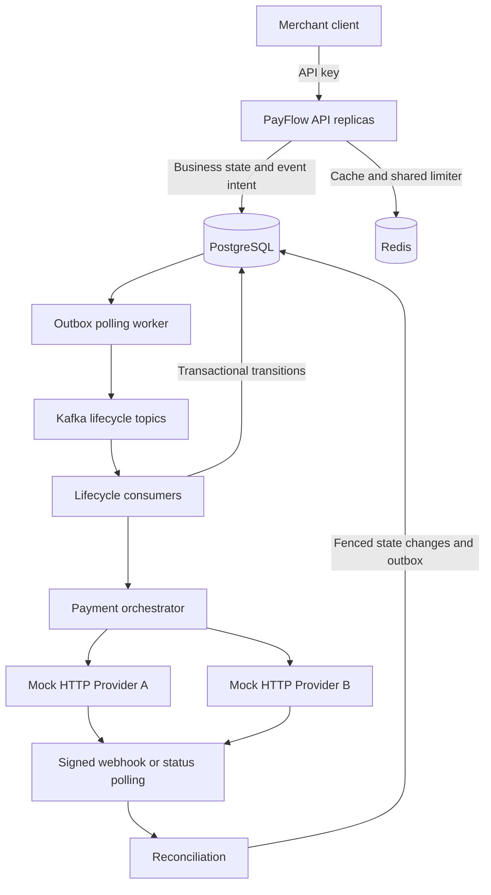
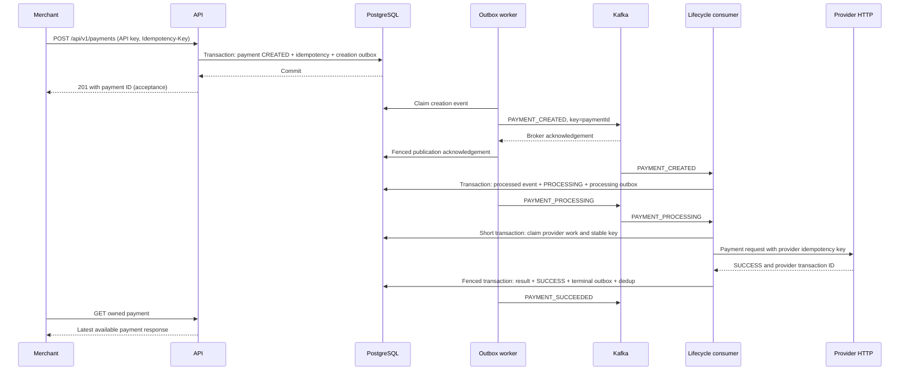
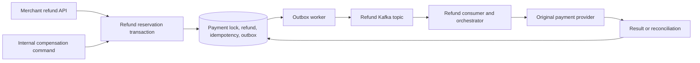

# Architecture

PayFlow is one logical Spring Boot application replicated across Pods, not independently deployed microservices. API handlers, outbox polling, Kafka listeners and reconciliation workers run in the application. PostgreSQL owns durable financial/workflow state; Redis accelerates reads and coordinates admission. Mock provider HTTP endpoints simulate external failure boundaries.

## Components and ownership

| Component | Responsibility |
|---|---|
| `PaymentController` | Validated HTTP boundary; merchant comes from the authenticated principal. |
| `PaymentService` | Validates currency/key, checks replay before rate admission, serves owned cache/database reads and bounded pagination. |
| `IdempotencyService` | Separate transactional bean atomically saves payment, request fingerprint and creation outbox row; collision replay happens after rollback. |
| `RateLimitService` | Runs an atomic Redis Lua fixed-window counter shared by replicas. |
| `PaymentCacheService` | Cache-aside payment detail, 300 s default TTL, database fallback and after-commit eviction. |
| `OutboxService` | Serializes payment/refund event intent inside the caller's business transaction. |
| `OutboxPublisher` / `OutboxStore` | Claims ordered work under short leases, sends outside the transaction, records fenced acknowledgement or retry. |
| `PaymentEventConsumer` | Validates Kafka key against payment ID; delegates CREATED notifications and PROCESSING provider work. |
| `PaymentLifecycleService` | Durably deduplicates events; locks CREATED payment, moves it to PROCESSING and saves its next event atomically. |
| `PaymentOrchestrator` / `ProviderWorkflowStore` | Claim provider work, invoke HTTP without holding financial row locks, then persist fenced result and terminal intent. |
| `PaymentProviderRouter` / provider adapters | Validated payment-method routes/fallbacks; adapters classify provider business results versus technical/ambiguous failures. |
| `ProviderWebhookService` | Verifies raw-body signature, validates contract, dispatches payment/refund callback to durable reconciliation stores. |
| Payment/refund reconciliation services and schedulers | Claim due polls, query original provider, finalize known outcomes or retain unresolved work. |
| `RefundService` / `RefundCreationStore` | Owned API reads; lock original payment, reserve refundable balance, persist refund/idempotency/outbox. |
| `RefundOrchestrator` / `RefundStore` | Execute original-provider refund with durable request identity and fenced completion. |
| `PaymentCompensationService` | Internal idempotent compensation command creates a refund for available balance; no public compensation endpoint. |

Source: [application packages](../src/main/java/com/payflow/payment/). HTTP and transaction boundaries are deliberately separate to avoid keeping database locks open during slow provider calls.

## Successful payment sequence

The last GET may temporarily see cached earlier state; acceptance, durable completion and observation are separate milestones. Local after-commit eviction and TTL bound cache staleness, not an atomic Redis/database commit.

## Refund and compensation sequence

Reservations include CREATED, PROCESSING, SUCCESS and PENDING_CONFIRMATION refunds. A definitively failed refund releases available balance; an uncertain refund continues reserving it. Successful refunds update partial/full refund state. Compensation is a new business action that can itself fail or remain uncertain.

## Consistency model

| Boundary | Guarantee and practical consequence |
|---|---|
| Payment + idempotency + outbox | One local PostgreSQL transaction; no committed payment without its initial event intent. |
| Processed event + transition + outbox | Atomic local change for lifecycle transitions. Provider work additionally uses durable claims/attempts and fenced finalization across short transactions. |
| Refund reservation + intent | Parent payment row lock serializes balance decisions across replicas. |
| Kafka publication and consumption | Eventual, at-least-once; a DB transaction is not atomic with a broker acknowledgement. |
| Provider HTTP | External side effect; stable request keys and later reconciliation resolve uncertainty. |
| Redis cache | Eventual view; eviction failure or fill/eviction race can leave stale data until TTL. Financial decisions read/lock PostgreSQL. |

## Concurrency mechanisms

| Mechanism | Race it addresses |
|---|---|
| PostgreSQL uniqueness | Concurrent API creates cannot both own the same merchant/key; event and refund-reference uniqueness prevent duplicate durable records. |
| `SELECT ... FOR UPDATE` | Two transitions or refund reservations cannot decide from the same unlocked financial balance. |
| `SKIP LOCKED` | Parallel workers claim independent due work without blocking behind another worker's selected row. |
| Database-clock leases | Crashed owners do not hold work forever; recovery starts after the ownership interval. |
| Fencing tokens | An old worker's late completion cannot overwrite a newer claim's result. They do not cancel an HTTP request already sent. |
| Redis Lua | Counter increment, expiry and admission decision happen atomically on Redis across replicas. |
| Kafka key and partition | Payment-related events share a partition; delivery ordering is per partition, not global or an external-side-effect transaction. |

Outbox selection also holds newer events for an aggregate behind its unpublished older event. Same-key ordering is supported by publisher ordering and transactional state guards, not Kafka alone. See [outbox](outbox.md), [idempotency](idempotency.md), and [trade-offs](design-decisions.md).

## Scaling boundary

Application replicas share durable claims, Redis and Kafka groups. Three topic partitions bound active consumer assignments for each group at the configured concurrency. CPU HPA and PDB exist; HPA does not react directly to Kafka lag. Scaling replicas also multiplies connection pools and provider calls, requiring DB/provider budgets. The local overlay caps HPA at two replicas; the base allows two to six. **three-replica/HPA validation could not be completed on the local Mac environment**. Configuration is present; full three-replica autoscaling performance validation is not proven.
