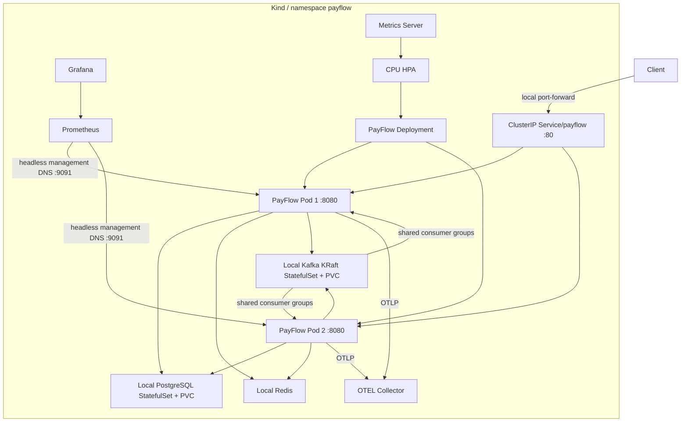
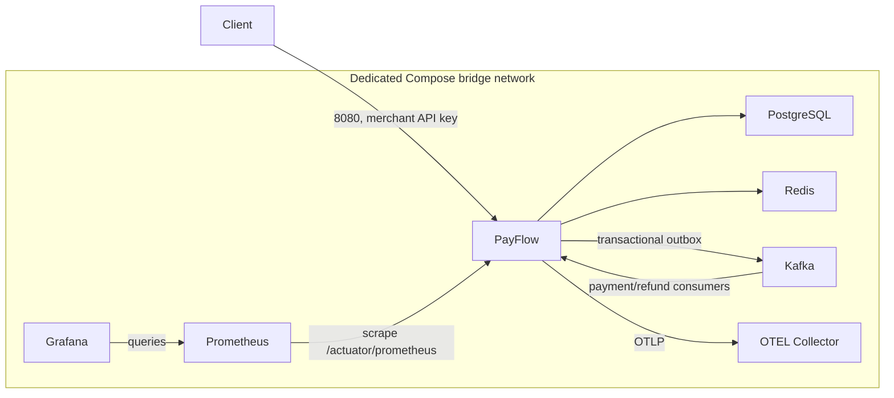
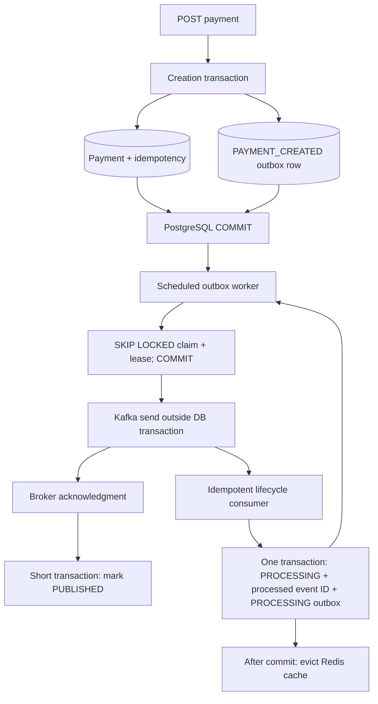
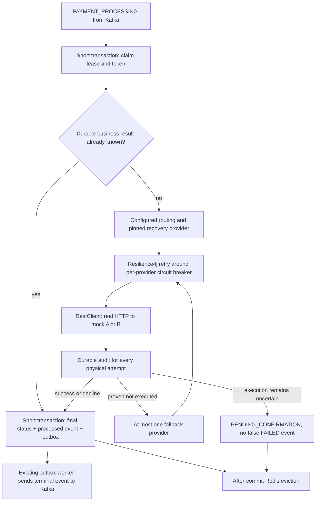
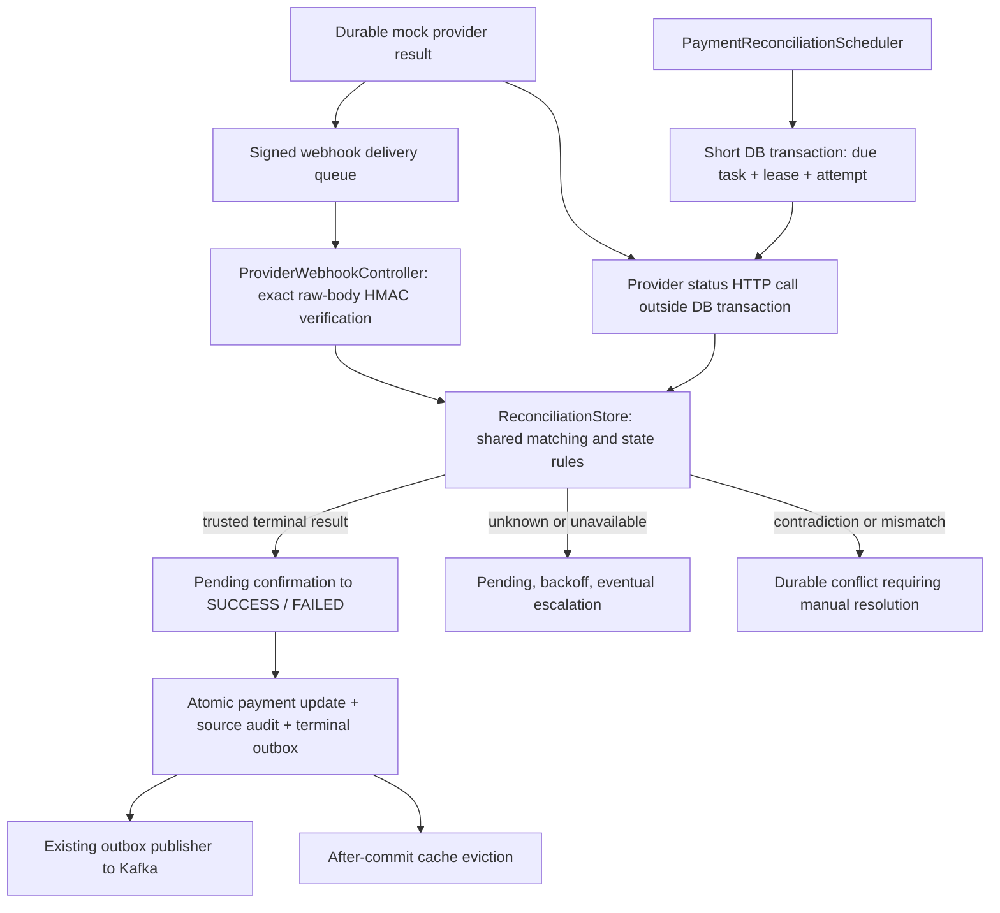
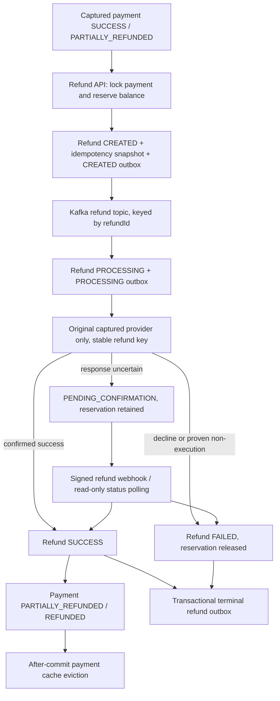
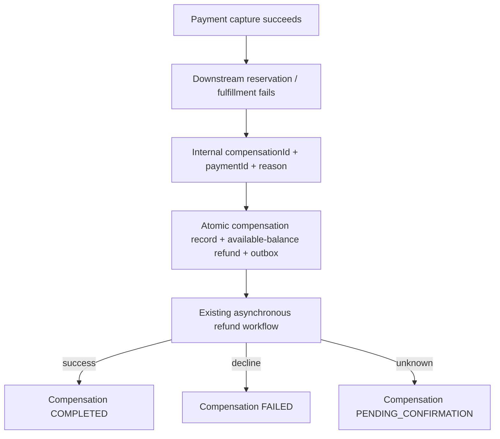
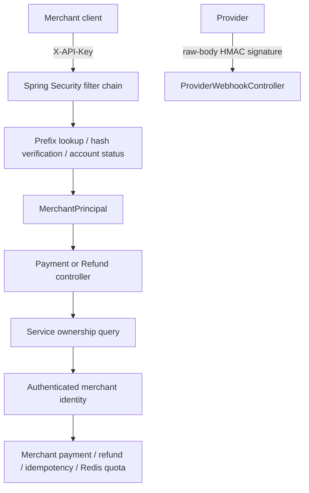

# Development history and detailed operational notes

This preserves the pre-refactor README. Its step-specific counts, scope statements and measurements are historical snapshots; use [the main README](../README.md) and [current testing](testing.md) for current status. File paths in old commands are illustrative.

# PayFlow

PayFlow will become a distributed payment orchestration platform built with Java 21 and Spring Boot 3.5.16.

## Current scope

Step 15: k6 load testing, profiling and evidence-based performance engineering. Steps 1–14 remain in place. No frontend, cloud deployment or microservice split is added.

## Step 15: Performance Testing

See [performance guide](../performance/README.md), [baseline measurements](../performance/BASELINE.md) and [optimization evidence](../performance/OPTIMIZATIONS.md), and [changed-file inventory](../performance/FILES.md). Load tests run separately from `mvn clean verify`.

```bash
API_KEY_FILE="$PWD/secrets/performance.api-key" PAYMENT_ID="<owned payment UUID>" \
  k6 run performance/k6/payment-read.js
```

For multiple Kubernetes replicas, use the in-cluster runner and documented isolated environment; a port-forward reaches one Pod. Start with smoke, then measured business workloads. See the performance guide for seeding, cache comparisons, stress, spike, 15-minute soak, JFR and safe restoration.


## Running PayFlow on Kubernetes

Step 14 uses **Kind 0.33.0**, a pinned Kubernetes **1.36.4** node image and Kustomize. The base deploys only the stateless PayFlow application; the local overlay adds single-instance development PostgreSQL/Kafka StatefulSets, ephemeral Redis, Prometheus, Grafana and OTEL. The Step 14 foundation adds no Helm, cloud deployment, ingress, Terraform or microservice split; Step 15 performance tooling is documented above.

### Files and Kubernetes resources

```text
k8s/
├── base/
│   ├── namespace.yaml
│   ├── serviceaccount.yaml
│   ├── deployment.yaml
│   ├── service.yaml
│   ├── management-service.yaml
│   ├── configmap.yaml
│   ├── hpa.yaml
│   ├── pdb.yaml
│   └── kustomization.yaml
└── local/
    ├── kustomization.yaml
    ├── kind-config.yaml
    ├── deployment-patch.yaml
    ├── secrets.env.example
    ├── install-metrics-server.sh
    ├── postgres/       # StatefulSet + headless Service
    ├── redis/          # Deployment + Service
    ├── kafka/          # KRaft StatefulSet + headless Service
    └── observability/  # Collector, Prometheus, Grafana, metrics discovery
```

The base renders eight resources. The local overlay renders 28: one namespace, one ServiceAccount, seven ConfigMaps, one generated Secret, nine Services, five Deployments, two StatefulSets, one HPA and one PDB. The two StatefulSets create their own PVCs. Metrics Server is installed separately in kube-system. `observability/kustomization.yaml` generates ConfigMaps from existing monitoring assets; three `scripts/k8s-*.sh` helpers cover image loading, merchant bootstrap and smoke checks.

### Local setup

Install Docker with Compose, `kubectl` and [Kind](https://kind.sigs.k8s.io/docs/user/quick-start/). Allow at least 10 GB of free system-drive disk space and 4–6 GB of Docker memory; more helps during three-replica/rolling demonstrations. Run from `~/Desktop/payflow`. The verified checkout already has private local credentials; preserve them. If the Step 13 Compose stack is running, stop it with `docker compose stop` first to avoid running both complete stacks on a constrained machine. For a fresh checkout:

```sh
# The application/Collector Dockerfiles are reused from Step 13.
# These builds do not require a Compose .env file.
docker build -t payflow:local .
docker build -t payflow-otel-collector:local observability/otel

mkdir -p secrets
kind create cluster --name payflow --config k8s/local/kind-config.yaml \
  --kubeconfig "$PWD/secrets/kind-kubeconfig"
chmod 600 secrets/kind-kubeconfig
export KUBECONFIG="$PWD/secrets/kind-kubeconfig"

# Official direct load works on ordinary Docker stores:
kind load docker-image payflow:local --name payflow
# Load both custom images; kubelet pulls official pinned dependencies.
# The helper retries a platform-specific stream for Docker Desktop index issues.
./scripts/k8s-load-images.sh

cp k8s/local/secrets.env.example k8s/local/secrets.env
# Fill every blank independently using: openssl rand -hex 32
chmod 600 k8s/local/secrets.env
kubectl kustomize k8s/base
# Local output includes base64 secrets: validate without printing it.
kubectl kustomize k8s/local >/dev/null
kubectl apply --dry-run=client -k k8s/local
kubectl apply -k k8s/local
./k8s/local/install-metrics-server.sh
kubectl get pods -n payflow -o wide
kubectl rollout status deployment/payflow -n payflow --timeout=600s
kubectl get hpa,pdb -n payflow
kubectl top pods -n payflow
```

`KIND_BIN=/path/to/kind ./scripts/k8s-load-images.sh` supports a separately installed binary. Local image pull policy is IfNotPresent; no registry push is required. Rebuilding the same local tag does not replace running Pods: load it into Kind and restart the Deployment, or use a new version tag for a reviewable rollout.

The base image tag is configurable through Kustomize's images transformer; the local overlay selects `payflow:local`. PostgreSQL/Redis/Kafka addresses are ConfigMap values that a future production overlay can replace with separately managed services. No production stateful cluster is claimed by these local manifests.

### Access and merchant bootstrap

Use separate terminals for port-forwards:

```sh
export KUBECONFIG="$PWD/secrets/kind-kubeconfig"
kubectl port-forward -n payflow service/payflow 8080:80
# Optional local operator access, never an Internet-facing management Service:
kubectl port-forward -n payflow service/payflow-management 9091:9091
kubectl port-forward -n payflow service/prometheus 9090:9090
kubectl port-forward -n payflow service/grafana 3000:3000
```

```sh
curl http://localhost:8080/api/v1/health
curl http://localhost:9091/actuator/health/readiness
./scripts/k8s-bootstrap-merchant.sh
# Owner-only output: secrets/kubernetes-merchant.api-key. Never prints the key.
PAYFLOW_API_KEY_FILE=secrets/kubernetes-merchant.api-key ./scripts/k8s-smoke-test.sh
```

The bootstrap helper reuses the existing non-web credential CLI in a running Pod, copies its secure issuance file to a mode-0600 host file and removes the Pod copy. It refuses overwrite; pass a different merchant/output path for an additional credential. The smoke test checks rollout, internal readiness, the API health endpoint and optionally creates a payment and waits for SUCCESS. The optional HTTP check needs Python 3 for JSON parsing. `PAYFLOW_NAMESPACE` and `PAYFLOW_URL` support namespace/forward-port overrides.

The manual payment curl example in the Compose section also works through the Kubernetes API forward when using `secrets/kubernetes-merchant.api-key`. Grafana admin username is `payflow`; its password comes from the ignored Kubernetes secrets file. Provisioning reuses the existing Step 12/13 dashboard, datasource and alerts. The Kubernetes and Compose databases/credentials are independent.

A Service forwards to ready endpoints across Pods. **A kubectl Service port-forward selects a single Pod**; it is convenient for local access but cannot prove distributed balancing. Functional multi-replica validation sends actual ClusterIP requests from inside the cluster and also alternates direct Pod targets where that makes shared coordination explicit.



### Probes, lifecycle and resources

The explicit `kubernetes` Spring profile binds management to **0.0.0.0:9091 inside the Pod**. The API Service exposes only 80→8080. Internal management Services expose 9091; metrics are permitted only by explicit observability/Compose/Kubernetes profiles, while sensitive Actuator endpoints remain denied and health detail remains hidden. Default and host-only Step 12 profiles retain their existing behavior. The base does not create public LoadBalancer/NodePort/Ingress resources.

- Startup checks liveness every 5 seconds, up to 36 failures (about 180 seconds), allowing JVM/Flyway/JPA/Kafka initialization before liveness enforcement. The local overlay allows 60 failures (about 300 seconds), based on observed cold startup under laptop memory pressure. Image pulling and init-container waits happen before application startup probing.
- Readiness checks every 5 seconds with three failures and an 8-second timeout, accommodating the bounded PostgreSQL/Redis health checks. Unready/terminating endpoints are removed from Service traffic.
- Liveness checks only Spring's liveness state every 15 seconds with three failures; external PostgreSQL/Redis/Kafka outages do not become liveness failures. PostgreSQL and Redis affect readiness; Kafka queues durable outbox work instead of making the API restart.

The Deployment starts with two replicas, keeps five revisions and uses maxUnavailable=0/maxSurge=1 with a ten-second ready soak. The base rolling replacement needs capacity for a third Pod. On the constrained local overlay, maxSurge=0/maxUnavailable=1 replaces one Pod at a time while keeping at least one Ready replica; it trades replica redundancy during rollout for a bounded two-JVM footprint. Use the base strategy on adequately sized clusters. A 120-second termination grace period preserves Step 13's actual graceful shutdown and 40-second per-phase Spring timeout. Java is PID 1 and receives SIGTERM. No arbitrary preStop sleep or leader-election mechanism is added; endpoint removal and Spring lifecycle hooks perform termination. Completed Java shutdown may report normal signal exit 143.

Each application Pod requests **250m CPU / 512Mi memory** and limits **1 CPU / 1Gi memory**. Requests reserve scheduling capacity and form the HPA utilization denominator; CPU limits throttle, memory limits can cause OOM termination. Java 21 is container-aware; MaxRAMPercentage=60 leaves space for non-heap/native memory, with InitialRAMPercentage=25. These are starting values, not measured production capacity; Step 15 can tune them.

Pods run UID/GID 10001, require non-root, use RuntimeDefault seccomp, drop all capabilities and disable privilege escalation. The application root filesystem is read-only; a size-bounded writable emptyDir provides /tmp. No hostPath or Docker socket is mounted. A minimal ServiceAccount has no application RBAC bindings, and token automount is disabled. Preferred anti-affinity encourages different nodes without preventing scheduling on single-node Kind.

### HPA, PDB and distributed correctness

The autoscaling/v2 HPA targets **70% of requested CPU**, with base min=2/max=6; the constrained local overlay caps at 2 to keep this 8 GB host stable. It adds at most one Pod per minute, waits 60 seconds for scale-up stabilization and uses a 300-second scale-down stabilization window before removing at most one Pod per minute. Memory-based scaling is intentionally omitted because Java heap occupancy is not a reliable request-load signal. Startup/readiness handling avoids counting initial unready JVM CPU as ordinary steady traffic. See [Kubernetes HPA behavior](https://kubernetes.io/docs/tasks/run-application/horizontal-pod-autoscale/).

HPA needs the resource metrics API, not Prometheus application metrics. The pinned Metrics Server installer is separate cluster tooling, accepts only the dedicated `kind-payflow` context, and applies a **local-only --kubelet-insecure-tls exception** for Kind kubelet certificates. Real clusters must use valid certificates. `<unknown>` targets are not proof of working autoscaling; inspect Metrics Server logs/APIService and wait for data. The local min=max=2 cap means automatic replica growth is deliberately unavailable on this constrained machine; it still validates the metrics pipeline and HPA target. On a larger machine, set local maxReplicas to 3 or higher before a bounded temporary CPU-only demonstration and restore it afterward. No permanent load code is added to PayFlow.

CPU falling below the 70% target does not guarantee a three-to-two scale-down: HPA rounds its replica recommendation up. With three replicas and uniform requests, roughly 46% average utilization or lower is needed to recommend two, before stabilization and missing/startup-metric handling. Periodic workers and JVM startup can keep CPU elevated even without HTTP traffic. Stopping a demonstration loop is therefore not the same as forcing replica reduction.

The policy/v1 PDB requires minAvailable=1. With two ready replicas it allows one voluntary disruption; with three it allows two. It constrains eviction-based voluntary maintenance, not direct Pod deletion, node failure or Deployment rolling strategy. Do not drain the only Kind node. Single-node replica spreading does not provide node-level availability.

Multiple JVMs reuse PostgreSQL API idempotency constraints, Redis shared rate limiting, outbox SKIP LOCKED/claim leases, provider/reconciliation lease fencing, shared mock provider result persistence and Kafka consumer groups. No per-JVM financial ownership or new leader election is added. Local demo scenario controls are process-local and must be set on every Pod when testing timeout scenarios; durable mock provider results remain in PostgreSQL.

Both topics have three partitions. The local ConfigMap uses consumer concurrency=1 per Pod; at two replicas useful assignments are two partitions on one consumer and one on another, and at three replicas one each. Useful active consumer parallelism per topic is bounded by partition count; additional API replicas do not create more partitions. Payment and refund listeners use separate shared groups, with the refund group suffixed `-refunds`. Base maximum six API replicas is not a claim of six active consumers per three-partition topic.

The local rate limit is ten new payment attempts per merchant per minute, allowing a small functional check to demonstrate a shared 429 threshold across Pods; the base keeps 100. Replays retain existing idempotency behavior. The base/local distinction is made with Kustomize patches, not duplicated application Deployments.

### Rollouts, configuration and diagnostics

```sh
kubectl get configmap payflow-config -n payflow -o yaml
# Only metadata/key counts; do not print/decode the generated Secret data.
kubectl get secrets -n payflow
kubectl get events -n payflow --sort-by=.lastTimestamp
kubectl logs -n payflow deployment/payflow --tail=100
kubectl rollout status deployment/payflow -n payflow
kubectl rollout history deployment/payflow -n payflow

# Stable ConfigMap env values are read at startup; apply then restart:
kubectl apply -k k8s/local
kubectl rollout restart deployment/payflow -n payflow
# Generated Secret/observability ConfigMap name hashes change references and roll Pods.
```

For a rollback demonstration without fabricating a broken application:

```sh
docker tag payflow:local payflow:v1
docker tag payflow:local payflow:v2
kind load docker-image payflow:v1 payflow:v2 --name payflow
# Use the platform-specific stream fallback described by k8s-load-images.sh if needed.
kubectl set image deployment/payflow payflow=payflow:v1 -n payflow
kubectl rollout status deployment/payflow -n payflow
kubectl set image deployment/payflow payflow=payflow:v2 -n payflow
kubectl rollout status deployment/payflow -n payflow
kubectl rollout undo deployment/payflow -n payflow
kubectl rollout status deployment/payflow -n payflow
```

v1/v2 are distinct demonstration tags of the same reviewed application image; they trigger real Pod rollouts, not a new payment feature. For an explicit three-replica test, coordinate with the HPA owner: temporarily set its min/max to three, scale the Deployment, verify Pods/payments, then restore local min=2/max=2 (or your documented machine-appropriate local cap). Otherwise HPA may reverse a manual scale.

### Step 14 verification evidence

Validation uses small functional requests, not a traffic benchmark. On this checkout:

- `mvn clean verify`: **270 tests, zero failures/errors/skips**; migrations V1–V8 retain their earlier SHA-256 hashes.
- Kustomize base/local rendering, strict Kubernetes 1.36 schema checks (**36 resources total, no errors**) and client/server apply dry-runs pass.
- Two replicas passed UID 10001, read-only root, writable /tmp, disabled ServiceAccount-token mount, resources, explicit Secret references and separate API/management checks. ConfigMap contains no secret values; private credential/kubeconfig files are mode 0600 and ignored.
- Twenty real ClusterIP health requests incremented both Pods' meters (9/11 split). Four concurrent identical requests returned one payment ID and one database row; original creation is 201, idempotent replay is 200.
- Alternating direct Pod targets accepted ten new requests for one merchant, then returned a shared Redis-backed 429 on the eleventh.
- Batch payments completed; all related outbox events were published and consumed. Both workers logged publication. Reconciliation produced a pending attempt followed by exactly one terminal APPLIED attempt, released its owner lease and left no STARTED audit.
- At the initial two-Pod Kafka snapshot, payment partitions 0/1 belonged to 10.244.0.4 and partition 2 to 10.244.0.9, all with zero lag. Pod IPs/assignments change on replacement; consumer groups remain shared.
- Stopping only local Redis made both application Pods Unready and removed ready API endpoints, while liveness stayed UP and restart counts stayed unchanged. Restoring Redis restored readiness and persisted payment access.
- Deleting one application Pod removed its endpoint, preserved successful Service health requests through the survivor, captured graceful HTTP/Kafka/database shutdown and produced a Ready replacement. Three replicas also became Ready and a payment created in that configuration reached SUCCESS.
- The bounded local `v1` → `v2` rollout kept at least one Ready replica; all 22 sampled ClusterIP health calls returned 200 and starting Pods remained outside Ready endpoints. `rollout undo` restored two Ready `v1` replicas and the original persisted payment remained SUCCESS.
- A Kubernetes refund reached SUCCESS; two refund-group members shared partitions 0/1 on 10.244.0.28 and partition 2 on 10.244.0.27. Empty partitions had no committed offset; the populated partition had zero lag.
- Prometheus discovered both individual Ready Pod addresses; the provisioned Grafana dashboard returned actual payment metric data and the Collector received OTLP traces. Sensitive Actuator routes remain denied, and local secret values were absent from application logs.

The first cold three-replica wait exceeded 180 seconds on an 8 GB host/4 GB Docker VM; the payment subsequently completed. A surge rollout under severe host swapping lost replica redundancy and hit its verification deadline; that attempt is not counted as a successful availability test. The local overlay now gives startup five minutes, rolls one Pod at a time with no surge, and caps HPA at two. Monitoring was temporarily paused for the bounded rollout checks and is restored for final observability checks. The base retains zero-unavailable/surge-one rollout and min=2/max=6 HPA. After IntelliJ was fully quit, the HPA maximum was temporarily raised to three for a bounded **150-second CPU-only loop**. Metrics started at 61%; Kubernetes recorded SuccessfulRescale to three, and all three replicas became Ready with 229% reported CPU. After the loop stopped, a five-minute observation still showed about 71% CPU and a recommendation of three. **Automatic CPU-driven scale-down was not observed**; restoring the local maximum to two returned the cluster to two replicas. That cap restoration is not evidence of a natural scaling cycle, and no polling/CPU-request performance tuning was introduced.

A separate Kafka CLI JVM per readiness probe caused avoidable local pressure and was replaced with a TCP probe. An initial Prometheus nested read-only mount was corrected using a separate alerts directory and a writable-data fsGroup. Application counters reset when JVMs are replaced; the final dashboard check creates a fresh completed payment and waits for a Prometheus scrape. Dashboard counter rates should account for resets. The shipped Kubernetes smoke script also passed readiness, API health and authenticated payment completion through the loopback port-forward. Final snapshot after cap restoration: application Pods used about **68m CPU / 468Mi** and **123m CPU / 481Mi**, with HPA **38%/70%**. These are short local functional-test observations, not production capacity figures.

| Final resource | Observed state |
| --- | --- |
| Deployment/payflow | 2/2 Ready and available, image payflow:local |
| Redis, OTEL, Prometheus, Grafana Deployments | 1/1 Ready each |
| PostgreSQL, Kafka StatefulSets | 1/1 Ready each; development only |
| Services | Nine ClusterIP Services, including three headless; no external IPs |
| PostgreSQL/Kafka PVCs | Both Bound, 2Gi each |
| HPA/payflow | CPU 38%/70%, min=2/max=2 local cap; base min=2/max=6 |
| PDB/payflow | minAvailable=1, one disruption allowed |
| Generated Secret | Five keys; values never printed or committed |

All eight namespace Pods were Ready at final verification. The API loopback port-forward is running at http://localhost:8080; a later Pod replacement can end a forward, so restart it with the access command if needed. Compose remains stopped, with its separate named volumes preserved. Temporary in-Pod verification credential headers were removed.

### Secrets and local infrastructure limitations

`k8s/local/secrets.env.example` has blank placeholders; `secrets.env`, kubeconfig and credential files are ignored and owner-readable. Kustomize generates a hash-suffixed Secret; committed Deployment env entries contain only references. PayFlow receives only DB_PASSWORD, API_KEY_PEPPER and two webhook secrets; PostgreSQL/Grafana receive only their own needed values. Keep the pepper stable for existing API keys and the PostgreSQL password consistent with the persisted database role.

Base64 Secret data is **not encryption**. Restrict Secret read/list/watch and Pod creation/exec through RBAC, enable etcd encryption at rest, protect kubeconfigs and use a production secret manager in a future deployment. Kind does not implement these production controls here. Do not commit or print rendered local YAML, decode Secret values into logs, or treat a loopback port-forward as public deployment hardening. See [Kubernetes Secret guidance](https://kubernetes.io/docs/concepts/security/secrets-good-practices/).

PostgreSQL and Kafka are **single-instance development StatefulSets**, each with a 2Gi PVC using Kind's default provisioner. Redis is deliberately ephemeral; financial correctness remains in PostgreSQL. Prometheus/Grafana use development emptyDir storage and lose local history/settings when replaced; their configurations/dashboard are automatically reprovisioned. OTEL uses the existing debug exporter, not a searchable trace database. Kafka uses a lightweight local TCP readiness probe; actual payment and consumer-group checks verify broker protocol behavior. This avoids spawning a second JVM on every probe. Kafka has a stable DNS-advertised KRaft broker address and publishNotReadyAddresses for its headless quorum Service; it does not advertise host localhost. There is no production HA, TLS, broker authentication or backup strategy.

Kind's default kindnet does not enforce NetworkPolicy; no misleading policy is enabled. Management remains ClusterIP-only, but namespace/network peers can reach permitted metrics: use an enforcing CNI and deliberate management ingress/egress policies in a future production overlay. The base can be reused for that overlay without including these development databases or cloud resources.

```sh
# Clean up the dedicated local cluster only when intentionally finished.
kind delete cluster --name payflow
# Deleting Kind destroys its local PVC contents. Keep any needed data separately.
# Compose's separate named volumes were preserved and can be resumed:
docker compose up -d
```

Step 14 adds k8s/base and k8s/local manifests, Kubernetes operator scripts, an observability Kustomize generator package and application-kubernetes.yml. SecurityConfig changes only to permit the existing selected management metrics in the explicit Kubernetes profile. Business code, database migrations and prior Compose configuration remain unchanged.

## Run PayFlow locally with Docker Compose

Install Docker Engine/Desktop with the Compose plugin. Allow roughly **4–6 GB** of Docker memory and space for the seven images/volumes. Java/Maven are needed for host tests, not for Compose onboarding. All commands run from `~/Desktop/payflow`. This verified checkout already has an ignored `.env` and local merchant credential; preserve them when restarting it. The copy/setup commands below are for a fresh checkout.

```sh
cp .env.example .env
# Edit every blank secret. Generate independent values with: openssl rand -hex 32
chmod 600 .env
docker compose config --quiet
docker compose up --build -d
docker compose ps
curl http://localhost:8080/actuator/health/readiness
./scripts/docker-smoke-test.sh
```

Foreground `docker compose up --build` also works. `.env.example` contains only public settings and blank secret placeholders; Compose refuses missing secrets. API_KEY_PEPPER must contain at least 32 bytes and remain stable to validate persisted credentials. Generated local verification secrets are kept only in the ignored, owner-readable `.env`; never commit it. These environment variables are a local convenience, visible to Docker administrators, not a production secret-management system.

| Service | Host access | Internal address / persistent state |
| --- | --- | --- |
| PayFlow | http://127.0.0.1:8080 | `payflow:8080`; application image runs as UID/GID 10001 |
| PostgreSQL | Not published | `postgres:5432`; `postgres-data` |
| Redis | Not published | `redis:6379`; intentionally ephemeral cache/limiter coordination |
| Kafka | 127.0.0.1:19092 for host tools | `kafka:9092`; `kafka-data` |
| Prometheus | http://127.0.0.1:9090 | `prometheus:9090`; `prometheus-data` |
| Grafana | http://127.0.0.1:3000 | `grafana:3000`; `grafana-data` |
| OTEL Collector | Not published | `otel-collector:4318` HTTP OTLP, 4317 gRPC, 13133 health |

All host publications bind to loopback. Optional host port overrides are listed in `.env.example`; pass the corresponding PAYFLOW_URL/PROMETHEUS_URL/GRAFANA_URL to the smoke script if ports change. Sign into Grafana using GRAFANA_ADMIN_USER/GRAFANA_ADMIN_PASSWORD from `.env`. The Prometheus datasource and **PayFlow operations** dashboard in the **PayFlow** folder are provisioned automatically. Grafana credentials initialize its persisted database once; changing `.env` later does not rotate an existing Grafana admin password.

Create a local merchant credential using the existing secure bootstrap profile:

```sh
./scripts/docker-bootstrap-merchant.sh local-demo-merchant
# Creates secrets/local-merchant.api-key with mode 0600, without logging the key.
PAYFLOW_API_KEY_FILE=secrets/local-merchant.api-key ./scripts/docker-smoke-test.sh
```

The helper executes the existing non-web bootstrap CLI inside the non-root PayFlow container, copies its owner-only temporary issuance file to the host, then deletes the container copy. It refuses to overwrite an existing file. For another explicitly requested credential, supply a new output path as the second argument. This is an operator workflow with local Docker/database access, not a public credential-issuance API. Keep the output in client secret storage; it is not retrievable later.

A manual payment example, with the raw key kept out of command history:

```sh
API_KEY=$(cat secrets/local-merchant.api-key)
curl -sS http://localhost:8080/api/v1/payments \
  -H "X-API-Key: $API_KEY" \
  -H 'Idempotency-Key: local-payment-001' \
  -H 'Content-Type: application/json' \
  -d '{"userId":"local-user","amount":100,"currency":"USD","paymentMethod":"UPI"}'
# Read the returned payment id:
curl -sS http://localhost:8080/api/v1/payments/PAYMENT_ID -H "X-API-Key: $API_KEY"
```

The first response is CREATED; Kafka/outbox/provider work eventually produces SUCCESS with the default demo provider. Reusing the same idempotency key/body replays the original creation response; GET returns current status. MOCK_PROVIDERS_ENABLED=true is confined to Compose's local demo environment. Provider HTTP calls and callbacks default to the same running PayFlow process at its actual API port; container-local loopback is correct for these in-process mocks. Remote PostgreSQL/Redis/Kafka/OTLP services use Compose DNS, never localhost. Random-port integration tests retain their existing behavior.



### Build, networking and dependency policy

The application Dockerfile uses a Maven 3.9.11 / Java 21 build stage and a Temurin Java 21 JRE runtime stage. `pom.xml` is copied before source and the Maven download cache stays in BuildKit, outside runtime layers. The runtime contains the executable JAR and curl for probes; it contains no Maven, source, test reports or build cache. `target/`, `.env*`, credentials, secrets, IDE metadata and data directories are excluded from build context. No secret is a build ARG or copied into the image. All base/service tags are explicitly pinned by major or version; none use latest. Major Java runtime tags can receive maintenance updates, so byte-identical base reproducibility would require digest pinning in a later release process.

Docker image builds compile/package with `-DskipTests`, because Testcontainers must not require Docker-inside-Docker during builds. **Tests remain in the repository**; run `mvn clean verify` separately before accepting changes. `docker build -t payflow:local .` builds from source and never uses the host's target JAR. The application has a read-only root filesystem, writable /tmp tmpfs, no Linux capabilities, no privilege escalation and no Docker socket. Logs remain structured JSON on stdout/stderr. PAYFLOW_JAVA_TOOL_OPTIONS supplies JAVA_TOOL_OPTIONS for the app, with local defaults of 60% maximum / 25% initial container RAM and a 1 GB app memory limit; tune for your development machine rather than hardcoding a huge heap. The separate bootstrap JVM uses a smaller heap.

Compose DNS names resolve within the project-scoped payflow-network bridge; no fixed container_name or container IP is required. Kafka runs one combined KRaft broker/controller, without ZooKeeper. The INTERNAL listener advertises **kafka:9092** to PayFlow. A separate HOST listener advertises **localhost:19092** to host clients; KAFKA_HOST_PORT changes its advertised host port and publication together. Controller traffic stays on kafka:9093. Replication/min-ISR values are one for this single-node demo, and a stable non-secret cluster ID matches the persistent Kafka volume. This is restart persistence, not production fault tolerance, replication, TLS or broker authentication.

PayFlow initially waits for PostgreSQL (`pg_isready`), Redis (`redis-cli ping`) and Kafka (broker API command) to become healthy. Flyway then migrates the database and Hibernate validates it, as before. Prometheus, Grafana and OTEL are not startup prerequisites for PayFlow. The Collector has a health_check extension and a static BusyBox HTTP probe added to its otherwise distroless official runtime; its health command tests the running receiver process, not merely configuration syntax. See [Compose health-aware startup semantics](https://docs.docker.com/compose/how-tos/startup-order/).

Startup ordering is a local orchestration convenience. Docker health status does not automatically restart an unhealthy process, and depends_on does not govern runtime outages. Infrastructure uses unless-stopped; the application allows only three on-failure restarts so configuration errors remain visible. At runtime the existing policy remains: PostgreSQL failure makes readiness DOWN; Redis failure makes readiness DOWN and creation unavailable while GET can use PostgreSQL; Kafka failure affects aggregate health and asynchronous progress while committed outbox work remains durable; observability failure does not prevent business APIs. Step 14 adds the separate Kubernetes dependency/rollout configuration documented above; Compose retains this behavior.

### Management and observability in Compose

The explicit `compose` Spring profile exposes only the already selected safe Actuator endpoints on the API port, including the requested `/actuator/health/readiness`. All host access is loopback-only and all management detail remains hidden. Merchant keys do not become operator credentials. This deliberately local demo permits info/metrics/Prometheus; it must not be used as a public deployment profile. The default application profile still denies management metrics, and Step 12's observability-local profile still binds its separate management server to 127.0.0.1:9091. No new proxy/controller or authentication system was added.

`prometheus-docker.yml` scrapes **payflow:8080** and reuses the Step 12 alert rules; the existing host Prometheus configuration is unchanged. Grafana uses `http://prometheus:9090`. Its dashboard datasource is a real datasource variable that works both with provisioning and manual imports, rather than an import-only placeholder. OTEL uses a separate Docker config binding its receiver/health ports to its container network interface; the existing host-only Collector config remains loopback-bound. The Collector uses a debug exporter, so successful trace receipt appears in `docker compose logs otel-collector`; retained searchable traces and alert routing remain deferred. Sampling stays configurable, default 0.1; set 1.0 temporarily for local trace debugging.

### Restart, outage and shutdown checks

```sh
docker compose restart payflow
docker compose restart postgres
# Payment rows and credentials persist in postgres-data.
docker compose restart redis
# Redis may lose cache/rate windows; financial rows are unaffected.

docker compose stop postgres
# Readiness becomes unavailable; restore without rebuilding:
docker compose start postgres

docker compose stop redis
# GET existing payments falls back to DB; new creation returns coordination failure.
docker compose start redis

docker compose stop kafka
# Create a payment: PostgreSQL/outbox commits, async completion waits.
docker compose start kafka
# Outbox/consumers reconnect and complete pending lifecycle work.

docker compose stop otel-collector
# Business requests continue; sampled traces may be dropped.
docker compose start otel-collector
```

Use `docker compose logs --tail=100 payflow` for diagnostics and `docker compose ps` for health status. Only stop/flush your disposable local Compose Redis instance; flushing it resets local rate windows and must not be done to a shared/production instance. No destructive reset is part of the default smoke script. Optional payment smoke creates one small demo payment using the supplied credential file.

Spring Boot graceful shutdown is explicit in the compose profile, with a 40-second per-phase lifecycle deadline and a 120-second Docker stop grace period. The exec-form entrypoint makes Java PID 1 and receives SIGTERM directly. Spring manages HTTP, Kafka listeners and scheduled workers; no unmanaged threads/System.exit hook was added. If a process is forcibly lost, existing outbox/provider/reconciliation fencing and leases retain recovery behavior. Logs need no application-log volume.

```sh
docker compose down
# Stops/removes containers and network; named volumes keep local data.

# Destructive reset: deletes PostgreSQL, Kafka, Prometheus and Grafana local data.
# Only run this intentionally on a disposable local environment:
docker compose down -v
```

Changing PostgreSQL credentials in .env does not rewrite an already initialized database volume. Keep values stable or rotate the database role deliberately. Four named volumes preserve PostgreSQL, Kafka, Prometheus (seven-day demo retention) and Grafana across container recreation. Redis persistence is intentionally disabled: payment correctness comes from PostgreSQL; cache entries and limiter windows are transient. No production backup, HA, TLS, image vulnerability scan, resource benchmark, Kubernetes/Helm/cloud provisioning or load testing is claimed.

### Step 13 files

```text
Dockerfile
.dockerignore
compose.yml
.env.example
src/main/resources/application-compose.yml
observability/prometheus/prometheus-docker.yml
observability/grafana/provisioning/datasources/prometheus.yml
observability/grafana/provisioning/dashboards/payflow.yml
observability/otel/Dockerfile
observability/otel/otel-collector-docker.yml
scripts/docker-bootstrap-merchant.sh
scripts/docker-smoke-test.sh
```

Modified: .gitignore (keeps .env.example trackable while secrets remain ignored), SecurityConfig (only explicit compose profile permits local management access), Grafana dashboard datasource variable and this README. Payment business code and V1–V8 migrations are unchanged. Implementation stops after Step 13.

### Step 13 verification results

Verified on Docker Desktop with all seven Compose services healthy:

- `mvn clean verify`: **270 tests, zero failures/errors/skips**, successful executable JAR packaging. Existing test sources and V1–V8 migration checksums are unchanged.
- Clean source-context multi-stage image build, `docker compose config --quiet`, Prometheus configuration/9 alert rules and Collector configuration validation passed.
- Application image `payflow:local`: **186,497,049 bytes (186.5 MB / 177.9 MiB)** on this machine. It runs as UID/GID 10001 and contains no Maven, javac, source tree, Maven cache, Docker socket or credential files. Image configuration/history and application logs were checked against the local secrets without printing them.
- Secure container bootstrap and the shipped optional authenticated payment smoke test passed. Three additional payments reached SUCCESS; two refund lifecycles reached SUCCESS. Unauthorized payment/webhook requests and sensitive Actuator access remained denied. Flyway applied all eight migrations.
- App/PostgreSQL/Redis restarts and a disposable Redis flush preserved persisted payments. PostgreSQL outage returned readiness 503 while liveness stayed 200. Redis outage preserved database-backed GET, returned 503 for new creation and recovered after restart.
- Kafka outage left committed work in the PostgreSQL outbox while API readiness remained UP; restarting Kafka completed the pending payment. Stopping OTEL did not prevent a payment reaching SUCCESS.
- Prometheus target was UP with payment series present. Grafana automatically provisioned the dashboard and returned actual Prometheus data through its datasource. Collector logs confirmed trace receipt.
- SIGTERM completed graceful HTTP shutdown, stopped Kafka consumers/producer and closed the database pool within the 120-second Docker deadline. Java's normal signal exit was **143 (128 + SIGTERM 15)**, with no OOM kill or SIGKILL. PayFlow restarted and read the persisted payment.

During validation the Grafana probe was corrected to use its installed `/usr/bin/curl`; the base image has no `/bin/wget`. A temporary verification assertion was also corrected to distinguish a partially refunded payment from SUCCESS and to accept Java's normal SIGTERM exit code. These fixes did not require payment logic changes. At the end of Step 13, the complete Compose stack was left running healthy. Step 14 validation stops it while preserving its named volumes. This remains a single-node local demo with plaintext internal infrastructure, debug-exported traces and no production HA, backup, TLS or cloud deployment.

## Requirements

- Java 21 JDK; set `JAVA_HOME` to its installation
- Maven 3.6.3 or newer
- PostgreSQL (tests use PostgreSQL 17.6)
- Redis for normal local operation (tests use Redis 7.4.2 with Lettuce)
- Kafka for normal local operation (tests use Apache Kafka 3.9.1)
- A running Docker-compatible runtime for Testcontainers tests; Docker Compose also supports the full local deployment described above

## Local database setup

With PostgreSQL running and a local `postgres` role available:

```sh
createdb -h localhost -p 5432 -U postgres payflow
```

Alternatively, connect as an authorized PostgreSQL administrator and run:

```sql
CREATE DATABASE payflow;
```

Configure the application in your shell:

```sh
export DB_HOST=localhost
export DB_PORT=5432
export DB_NAME=payflow
export DB_USERNAME=postgres
read -s DB_PASSWORD
export DB_PASSWORD
# Supply a random secret of at least 32 bytes, managed securely outside this repository.
read -s API_KEY_PEPPER
export API_KEY_PEPPER
```

Enter your local database password at the `read` prompt. The first four settings have the defaults shown above. `DB_PASSWORD` and `API_KEY_PEPPER` have no defaults and must be supplied; no real credentials belong in source control. `.env` files are ignored, but Spring Boot does not automatically load them: export variables through your shell or configure your IDE's run environment.

For this local setup, the configured database role needs permission to create Flyway's history table, the payments table, and indexes. A production deployment can separate migration permissions from the application role in a later step.

## Run and build

```sh
cd ~/Desktop/payflow
mvn spring-boot:run
```

Or build and run the executable JAR:

```sh
mvn clean package
java -jar target/payflow-0.0.1-SNAPSHOT.jar
```

Port 8080 must be available. For a temporary override:

```sh
java -jar target/payflow-0.0.1-SNAPSHOT.jar --server.port=18080
```

## Test

Start your Docker runtime, then run:

```sh
mvn test
```

Testcontainers creates isolated PostgreSQL databases with test-only credentials; local `DB_*` values are not needed for tests. Full-context tests use real PostgreSQL and Redis containers; repository slice tests use PostgreSQL. Flyway runs the production migration, then Hibernate validates the resulting schema. The repository tests cover a flushed/cleared database round trip, an update timestamp, persisted currency codes, Flyway V1 history, and direct SQL rejection of a nonpositive amount. The health controller test remains an isolated MockMvc test. Payment API integration tests start the full application on a random HTTP port against PostgreSQL and cover creation, retrieval, pagination, sorting, validation, server-owned fields, and error responses.

The suite intentionally fails if Docker is unavailable; it does not silently skip persistence verification or use H2. To run only the independent HTTP controller test:

```sh
mvn -Dtest=HealthControllerTest test
```

## Health endpoint

```sh
curl -i http://localhost:8080/api/v1/health
```

Returns HTTP `200 OK`:

```json
{"status":"UP","service":"payflow"}
```

JSON property order may vary. This endpoint verifies HTTP handling; it does not independently query the database. Application startup requires PostgreSQL and the API-key pepper, unlike Step 1.

## Persistence design

- Flyway owns schema changes through `src/main/resources/db/migration/V1__create_payments_table.sql`. Add subsequent numbered migrations for changes; do not edit V1 after it has been applied to a persistent database.
- Hibernate uses `ddl-auto: validate`, with Open Session in View disabled and UTC JDBC handling. It never creates or updates the production schema. SQL logging is disabled by default.
- Payment IDs use standard JPA `GenerationType.UUID`, generated by Hibernate. Money uses `BigDecimal` mapped to `NUMERIC(19,4)`: 15 integer digits and 4 fractional digits, with matching Bean Validation and a database positivity constraint. Currency-specific minor-unit rules belong to later business validation.
- Currency uses `java.util.Currency`, explicitly converted to a three-letter ISO code. PostgreSQL checks the code format; Java validates recognized codes through `Currency.getInstance`. The SQL constraint does not claim to maintain the full ISO currency catalog.
- Methods and statuses are stored as strings and restricted by database CHECK constraints. Required fields have NOT NULL constraints; identifiers also have nonblank and length validation.
- `Instant` lifecycle callbacks populate both timestamps on insert and refresh `updatedAt` for JPA entity updates. PostgreSQL stores `TIMESTAMP WITH TIME ZONE`; callback precision matches its microseconds. Native SQL and bulk JPQL updates bypass callbacks and must maintain timestamps themselves.
- Indexes support merchant lookups, user lookups, and creation-time ranges. No standalone status index is added: four status values have low selectivity and no current status query exists. Revisit composite or partial indexes when actual access patterns emerge.

## Package structure

All packages are under `com.payflow.payment`:

- `controller`: payment/refund/health/webhook endpoints; merchant routes use authenticated principals and delegate ownership checks to services.
- `entity`: Payment, persistence enums, and the currency converter.
- `repository`: JPA queries, including payment/refund ownership and merchant pagination.
- `service`: payment orchestration, transactional idempotency, currency parsing, DTO mapping, cache-aside reads, and Redis rate limiting.
- `dto`: immutable creation, payment response, and pagination records.
- `exception`: domain exceptions and consistent API error handling.
- `config`: explicit typed JSON Redis serialization.

Kafka now coordinates the CREATED -> PROCESSING lifecycle described in Step 6 below. Step 8 adds mock provider execution over HTTP; real settlement and broader distributed workflows remain future work. Step 10 adds refunds; Step 11 adds merchant authentication and authorization. Redis is limited to cache-aside reads and merchant rate limiting.


## Payment APIs (Step 3)

Create a payment (201 Created for a new key; 200 OK for a matching replay, both with a Location header):

```sh
curl -i -X POST http://localhost:8080/api/v1/payments \
  -H 'Content-Type: application/json' \
  -H 'X-API-Key: YOUR_PAYFLOW_API_KEY' \
  -H 'Idempotency-Key: payment-attempt-123' \
  -d '{"userId":"USER-456","amount":2499.00,"currency":"INR","paymentMethod":"UPI"}'
```

Use the UUID returned in the response to retrieve the payment (200 OK):

```sh
curl -i http://localhost:8080/api/v1/payments/REPLACE_WITH_RETURNED_UUID -H 'X-API-Key: YOUR_PAYFLOW_API_KEY'
```

List with pagination and optional sorting (200 OK):

```sh
curl -i 'http://localhost:8080/api/v1/payments?page=0&size=20&sort=createdAt,desc' -H 'X-API-Key: YOUR_PAYFLOW_API_KEY'
```

Pages are zero-based; size defaults to 20 and must be between 1 and 100. Sorting supports only `createdAt` and `amount`, with `asc` or `desc`. Repeat the `sort` parameter for multiple fields. Default order is newest first, with UUID as a deterministic tie-breaker. Merchant ownership is always filtered by authenticated identity; no additional client-selectable filters are introduced.

List responses contain `content`, `page`, `size`, `totalElements`, and `totalPages`. Requests cannot provide `id`, `status`, `createdAt`, or `updatedAt`: these fields are server-owned, and unknown JSON fields are rejected. IDs and timestamps are generated during persistence, and creation always uses CREATED.

Request validation matches database lengths and money precision. Currency must be an uppercase three-letter code recognized by `Currency.getInstance`; unsupported currencies return 400. Amounts must be positive, with at most 15 integer digits and 4 fractional digits. Payment methods are UPI, CARD, NET_BANKING, and WALLET.

Invalid input, malformed UUIDs, and invalid pagination/sorting return 400; an unknown payment UUID returns 404. Errors have a consistent `timestamp`, `status`, `error`, `message`, and `path` structure, without stack traces. JPA entities are never returned directly.

The request flow is controller validation → service coordination → transactional PostgreSQL persistence → DTO response. GET-by-ID checks Redis first and uses the repository's read-only transaction on a miss; listing remains a read-only service transaction. The existing database constraints remain in force.


## Step 4: database-backed idempotent payment creation

Idempotency makes retries safe when the client cannot tell whether its previous request succeeded (for example, after a network timeout). Every POST now requires a nonblank `Idempotency-Key` header of at most 128 characters. Missing, blank, or oversized keys return 400.

Keys are scoped to the merchant: `(merchantId, Idempotency-Key)`. Two merchants can use the same key independently. Choose a stable key for one logical creation attempt and retain it when retrying; use a different key for a different payment.

- New key and merchant: create one payment and one idempotency row, return **201 Created**.
- Same key and merchant with the same logical request: return the existing payment UUID with **200 OK**, without another insert.
- Same key and merchant with a changed user, amount, currency, or method: return **409 Conflict** with the standard ApiError.

Repeat the creation curl example above to see a 200 replay. A changed-payload example using the same key:

```sh
curl -i -X POST http://localhost:8080/api/v1/payments \
  -H 'Content-Type: application/json' \
  -H 'X-API-Key: YOUR_PAYFLOW_API_KEY' \
  -H 'Idempotency-Key: payment-attempt-123' \
  -d '{"userId":"USER-456","amount":500.00,"currency":"INR","paymentMethod":"UPI"}'
```

If the earlier 2499.00 request succeeded, this returns 409. GET-by-ID, listing, health, and PaymentResponse fields are unchanged.

### Fingerprint

The server stores only a SHA-256 fingerprint of merchant ID, user ID, amount, ISO currency code, and payment method. Decimal trailing zeros are removed before hashing, so `2499`, `2499.0`, and `2499.00` are equivalent. Identifier values and keys retain their exact values (no application trimming or case folding). UTF-8 fields are length-prefixed to prevent ambiguous concatenation. JSON property order and whitespace do not affect the fingerprint. No full request JSON or sensitive payment data is stored in the idempotency table.

### Transaction and concurrency strategy

Flyway V2 creates `payment_idempotency`, including a foreign key to payments and a UNIQUE constraint on `(merchant_id, idempotency_key)`. V1 remains unchanged.

PaymentService validates the key and currency, computes the fingerprint, and calls a separate IdempotencyService Spring bean. Its `@Transactional(REQUIRES_NEW, isolation = READ_COMMITTED)` method looks for a replay and otherwise inserts the payment and idempotency row in one transaction. Flushing the inserts surfaces constraint violations before returning; both rows commit together before the controller responds.

The preliminary lookup is an optimization, not the concurrency guarantee. If two requests both find no record, PostgreSQL's unique constraint decides the winner. The losing request rolls back its entire transaction, including its tentative payment insert. Only this specific unique-constraint collision is recovered: PaymentService catches it outside the transactional proxy and calls a fresh read-only transaction to load the committed winner. Matching fingerprints return 200; different fingerprints return 409. Other database failures are not mistaken for retries. No synchronized block or JVM-local lock is used, so database correctness is shared across application instances.

PostgreSQL is used because payments and idempotency records can commit atomically in the same database. Redis does not decide idempotency and does not participate in these transactions; Step 8 mock provider effects use their own durable idempotency ledger. Records currently have no expiry or cleanup job; the guarantee lasts while the records are retained. It covers creation of the local payment record, not execution against a payment provider.

### Verification

`mvn test` runs PostgreSQL Testcontainers integration tests for creation, replay, normalized amounts, all fingerprint fields, merchant scoping, key validation, and concurrent requests. The concurrent tests hold a temporary PostgreSQL table lock until every request has reached the idempotency insert, forcing the losing transactions through real unique-constraint recovery. They verify one 201, matching 200 replays (or a 409 for a different payload), and exactly one row in each table. The lock exists only in tests; production uses the unique constraint and transaction rollback.


## Step 5: Redis-backed caching and rate limiting

### Local Redis setup and configuration

With Redis installed, start a local server in another terminal:

```sh
redis-server
```

The default local Redis connection is unauthenticated. Configure your shell or IDE as needed:

```sh
export REDIS_HOST=localhost
export REDIS_PORT=6379
export REDIS_PASSWORD=''
export PAYMENT_CACHE_TTL_SECONDS=300
export PAYMENT_CREATE_RATE_LIMIT=100
export PAYMENT_CREATE_RATE_WINDOW_SECONDS=60
```

These are also the defaults. Supply a real Redis password only through your runtime environment when authentication is configured; never commit it. TTL, limit, and window must be positive. PostgreSQL still requires the DB_* settings described above. No Docker Compose or application container configuration is included. Testcontainers provides isolated PostgreSQL and Redis for tests.

### Payment read cache

`GET /api/v1/payments/{id}` uses explicit cache-aside behavior:

1. Read `payflow:payment:{UUID}` from Redis.
2. On a hit, return the cached PaymentResponse without calling the repository.
3. On a miss, read PostgreSQL and map the entity to PaymentResponse.
4. Store typed JSON in Redis with the configured TTL (default 300 seconds).

Redis uses string keys and typed JSON values, including ISO timestamp strings. No native Java serialization, Hibernate entities, or polymorphic class metadata are stored. Missing payments are not cached; list results are not cached.

Creation does not populate the cache. The first GET populates it after the repository read transaction completes, so a rolled-back payment is never published through the creation path. `PaymentCacheService` exposes get, put, and evict for future update handling. Lifecycle status changes now evict after commit; an unavailable eviction can leave a stale value until TTL. Concurrent misses may each query PostgreSQL; no distributed cache lock is introduced.

Redis connection failures and command timeouts cause a warning and PostgreSQL fallback. Failed cache population or eviction does not fail the database response. Unreadable cached JSON also falls back and is overwritten on a successful read. Unrelated programming/database exceptions are not swallowed. Default Redis connect and command timeouts are one second each.

PostgreSQL remains the system of record. Flushing Redis removes optimizations and quota counters, not payments or idempotency records.

### Merchant creation rate limiting

New creation attempts use an atomic Redis Lua fixed-window counter at `payflow:rate:create-payment:{merchantId}`. The window begins with the merchant's first counted attempt and is not extended by subsequent or rejected attempts. Defaults are 100 attempts per 60 seconds per merchant.

The script increments the counter, attaches expiry on the first increment, checks quota, and returns remaining reset time atomically. It also repairs a counter accidentally missing expiry. All application instances using the same Redis share the counter; there is no JVM-local counter or lock. Fixed windows permit boundary bursts and depend on the Redis counter remaining available; loss/eviction of counter data resets quotas, while PostgreSQL payment correctness remains intact.

After the threshold, POST returns **429 Too Many Requests**, using ApiError with message `Payment creation rate limit exceeded`. `Retry-After` is the positive remaining window duration rounded up to seconds. Rejected attempts increment the counter without extending expiry. No payment/idempotency row is created for a rejected new attempt.

### Ordering and Redis availability

PaymentService first validates the body/key/currency and checks committed PostgreSQL idempotency records. A matching replay returns 200 without consuming quota; changed-payload reuse returns 409. A new attempt then checks Redis before entering the atomic payment/idempotency transaction. A final replay lookup after limiter rejection handles a winner that committed between checks.

Overlapping first attempts with the same key can each consume a slot before any winner commits. Failed creation attempts are not refunded. This conservative approach preserves abuse protection without moving idempotency decisions into Redis. PostgreSQL uniqueness and transaction rollback still guarantee one payment for a given merchant/key.

If Redis cannot coordinate the limiter, new creation attempts return **503 Service Unavailable** with a generic ApiError instead of bypassing quota checks. GET-by-ID falls back to PostgreSQL; committed replays and unchanged health continue to work. Cache operations and rate limiting are separate concerns with deliberately different availability policies.

### Try it locally

Create with the existing curl example (including Idempotency-Key), then use its UUID:

```sh
curl -i http://localhost:8080/api/v1/payments/REPLACE_WITH_RETURNED_UUID -H 'X-API-Key: YOUR_PAYFLOW_API_KEY'
curl -i http://localhost:8080/api/v1/payments/REPLACE_WITH_RETURNED_UUID -H 'X-API-Key: YOUR_PAYFLOW_API_KEY'
redis-cli GET payflow:payment:REPLACE_WITH_RETURNED_UUID
redis-cli TTL payflow:payment:REPLACE_WITH_RETURNED_UUID
```

The first GET fills the cache and the second can use it. To explore throttling locally, set `PAYMENT_CREATE_RATE_LIMIT=3`, restart PayFlow, and send four valid creations for one merchant with four distinct Idempotency-Key values within one window. The fourth returns 429. Retrying an already-created payment with its original payload/key still returns 200.

### Tests and logging

`mvn test` covers real Redis JSON round trips, cache hits without repository access, TTL expiry, eviction/flush, malformed JSON, timeout fallback, rate-limit thresholds, merchant isolation, window expiry, concurrent quota enforcement, and free committed replays. Redis timeout tests temporarily pause the isolated Redis container, verify HTTP behavior, and unpause it in a finally block. Earlier PostgreSQL concurrency/idempotency tests remain in the suite.

Normal cache hits/misses and rate rejections log at DEBUG; dependency fallback logs at WARN. No request bodies, passwords, or card data are logged or introduced.


## Step 6: Kafka lifecycle foundation

Start a local Kafka broker before `mvn spring-boot:run`. Supply its reachable listener:

```sh
export KAFKA_BOOTSTRAP_SERVERS=localhost:9092
mvn spring-boot:run
mvn test
mvn package
```

PostgreSQL and Redis configuration from earlier steps still applies. Integration tests create real PostgreSQL, Redis and Kafka containers automatically; they do not use an embedded or mocked broker. Earlier API suites disable lifecycle listeners and automatic outbox polling to keep their CREATED assertions deterministic; the dedicated Kafka suite starts the real listener explicitly.

The application declares `payflow.payment.events.v1` and `payflow.payment.events.v1.DLT`, each with three partitions by default. Kafka must permit topic creation, or an operator must provision both topics. Environment settings:

| Variable | Default | Purpose |
| --- | --- | --- |
| KAFKA_BOOTSTRAP_SERVERS | localhost:9092 | Broker discovery addresses |
| KAFKA_CONSUMER_GROUP | payflow-payment-lifecycle | Shared lifecycle consumer group |
| KAFKA_CONSUMER_CONCURRENCY | 3 | Listener threads per instance |
| KAFKA_TOPIC_PARTITIONS | 3 | Topic partition count |
| KAFKA_TOPIC_REPLICATION_FACTOR | 1 | Local single-broker default |
| KAFKA_TOPIC_MIN_ISR | 1 | Minimum in-sync replicas |
| KAFKA_LISTENER_AUTO_STARTUP | true | Start lifecycle consumption |

For a production multi-broker deployment, explicitly provision adequate replication and minimum ISR (for example 3 and 2). Increasing configuration does not automatically repair replication of existing topics. Broker authentication/TLS remains deployment configuration, not a feature introduced here.

### Request and event flow

1. POST validates the request, checks PostgreSQL idempotency, and applies Redis quota to new attempts.
2. A single transaction saves the payment, idempotency row and PAYMENT_CREATED outbox snapshot. Rollback prevents all three writes. Replays register no new event.
3. The Step 7 polling worker sends stored JSON keyed by payment UUID and marks the row PUBLISHED after acknowledgment. The 201 response contains the creation snapshot; a subsequent GET may already show PROCESSING.
4. The Kafka consumer validates the contract/key and calls transactional PaymentLifecycleService. A native PostgreSQL `INSERT ... ON CONFLICT DO NOTHING` claims eventId in the same transaction as the state update. A row lock serializes distinct event IDs targeting the same payment.
5. Only CREATED -> PROCESSING is permitted. A duplicate ID is skipped; another CREATED event for an already-PROCESSING payment is harmless and emits no further transition. Terminal states cannot move backward.
6. The transition transaction also inserts a PAYMENT_PROCESSING outbox snapshot. Commit triggers Redis cache eviction; the worker later publishes the snapshot. In Step 8, PAYMENT_PROCESSING invokes provider orchestration, which produces a terminal success/failure outbox event for a known outcome. SUCCEEDED/FAILED notifications are tracked without further transitions; uncertain execution becomes PENDING_CONFIRMATION.

PaymentEvent includes eventId, eventType, eventVersion (1), paymentId, merchantId, userId, amount, currency, paymentMethod, status and occurredAt. UUID eventId is distinct from paymentId, BigDecimal preserves money precision, enums serialize as strings, and timestamps are UTC ISO strings. JSON uses a fixed expected event class and the restricted `com.payflow.payment.event` trusted package; native Java serialization is absent.

A payment key sends its events to the same partition, preserving that partition's record order. Members of the same consumer group share partitions; another group has its own offsets. More listener threads than partitions cannot increase active parallelism. Producer idempotence reduces transport retry duplicates; it does not remove application duplicates or provide exactly-once database processing.

### Retries and dead-letter recovery

Producer configuration uses acks=all, idempotence, three retries, a 30-second delivery deadline and a three-second metadata blocking bound. Consumer offsets commit after successful record handling. The DefaultErrorHandler retries transient handling failures twice, one second apart, then publishes to the DLT on the original partition. Invalid contracts/transitions and deserialization failures go directly to the DLT. Malformed payload bytes are preserved with diagnostic headers. Failed DLT sends are surfaced so the source record is not silently acknowledged. Inspect and resolve DLT records operationally; no automatic replay endpoint is added.

Consumer event markers are durable in Flyway V3's processed_kafka_events table. Failed handling rolls back its marker and payment update together, making retries possible. Marker retention must preserve the intended deduplication window; no cleanup policy is introduced.

### Reliability boundary

Step 7 replaces the earlier AFTER_COMMIT Kafka send with a durable outbox (described below). PostgreSQL commit and Kafka delivery are still separate operations, but a committed change now always has its durable event intent. Publisher retries preserve eventId. Delivery remains at-least-once; permanently failed rows require operational resolution.

Redis eviction also runs after commit. Redis outage or a concurrent read refilling an older snapshot can leave a stale cached value until TTL; PostgreSQL remains authoritative. No distributed cache locking is added.

### Files and responsibilities

`event/` contains the immutable contract, enum/topic names, producer and thin consumer. `service/PaymentLifecycleService` owns transitions and transactional deduplication. `config/KafkaConfig` declares topics, serializers and retry/DLT policy. `entity/ProcessedKafkaEvent`, its repository and `V3__create_processed_kafka_events.sql` provide durable markers. V1/V2 are preserved. IdempotencyService saves creation outbox events only for new rows in its transaction; PaymentCacheService evicts committed status updates.

Tests cover real JSON publication, replay suppression, lifecycle/cache behavior, concurrent duplicate claims, terminal-state rejection, missing-payment retry recovery, invalid version rejection and malformed-JSON DLT preservation. Transport tests verify the stored payload/key and propagation of failures to the outbox worker.


## Step 7: Transactional Outbox

### Problem solved

Previously, PostgreSQL could commit a payment or status change and the process could fail before Kafka publication. There was no durable event to retry. The new guarantee is a **local atomic transaction**: the business change and its event intent either both commit or both roll back. Kafka is never called by a business transaction.



### Durable snapshot and transaction boundaries

Flyway **V4__create_outbox_events.sql** adds JSONB outbox storage; V1–V3 remain unchanged. `OutboxEvent.id` is the existing PaymentEvent.eventId. The record also stores payment aggregate ID, event type/version, status, timestamps, attempt count, safe error and claim metadata.

`OutboxService.savePaymentEvent` uses **MANDATORY** propagation, so it requires and joins the caller's transaction; it never opens an independent creation transaction. Jackson serializes the existing PaymentEvent once. JSONB normalizes the JSON representation while preserving its data. The publisher sends that stored snapshot as UTF-8 JSON rather than rebuilding it from the current payment. Serialization or insert failure rolls back the payment, idempotency row and event intent together.

A replay or conflicting idempotency key creates no second outbox event. The consumer commits the processed-event claim, CREATED -> PROCESSING update and processing outbox row together. Duplicate event IDs create no additional processing event. Redis eviction remains an independent after-commit action; its failure cannot roll back the database work.

### Polling, locking and leases

`OutboxScheduler` invokes `OutboxPublisher` with a fixed delay. Each poll processes at most the configured batch size. It claims **one row immediately before each send**, rather than leasing a large batch whose later leases might expire while earlier sends block.

`OutboxStore.claimNext` opens a short transaction and selects one eligible row with `ORDER BY created_at, id LIMIT 1 FOR UPDATE SKIP LOCKED`. It changes the row to CLAIMED, increments attempt_count, stores a random claim token and expiring lease, then commits. Other workers skip locked rows and cannot claim an unexpired lease. This uses PostgreSQL coordination, without JVM-local locks. See [PostgreSQL locking documentation](https://www.postgresql.org/docs/17/sql-select.html#SQL-FOR-UPDATE-SHARE).

The worker waits for the Kafka future **outside any PostgreSQL transaction**. After acknowledgment, a second short transaction marks PUBLISHED, sets published_at and clears the lease. Updates require the current claim token: an expired worker cannot overwrite a newer worker's result. PostgreSQL's clock supplies creation, eligibility and lease timing so differences between application clocks cannot make freshly committed events ineligible.

An abandoned claim becomes eligible when its lease expires. A send wait timeout retains the lease because the in-flight send might still complete. The default lease is longer than the send deadline and metadata-blocking allowance. Extreme process pauses beyond the lease can still lead to overlapping retries; token fencing protects database ownership but cannot cancel a Kafka send already in flight.

### Ordering and retry policy

Only the earliest unpublished row for a payment is claimable. PENDING, CLAIMED and FAILED predecessors block its successors; independent payments continue. This preserves intended per-payment order through concurrent workers, including the interval between broker acknowledgment and marking PUBLISHED. It does not provide global ordering across payments. The Kafka key/topic and Step 6 DLT policy remain unchanged.

A confirmed Kafka failure records only a bounded, generic error plus the exception class name (never broker exception text), clears its claim, and schedules a delayed retry. attempt_count counts durable claims, including attempts interrupted by process crashes. After the configured maximum, the row becomes **FAILED** and stays available for inspection. An expired final-attempt lease also becomes FAILED. Failed heads deliberately block later events for that payment; no admin replay API is added.

Outbox publishing failures stay in outbox metadata; they do not go to the consumer DLT. Consumer processing/deserialization failures still use the existing bounded retry and DLT policy. Published and failed rows are retained; archival, retention, metrics and operational replay are future work.

### At-least-once delivery

Kafka may acknowledge an event and the process may crash before the PUBLISHED update. After lease expiry, the worker sends the **same eventId and stored payload again**. This is at-least-once publishing, not exactly-once delivery. The durable consumer event-ID claim prevents duplicate business effects and additional processing outbox rows.

The outbox solves lost **event intent**, not every operational delivery problem. Healthy infrastructure and continued polling are needed for delivery; FAILED rows need intervention. Existing committed changes from before Step 7 are not backfilled automatically because their original event IDs/snapshots are unavailable. HTTP replay returns the existing payment; it does not manufacture a replacement event.

### Configuration

| Environment variable | Default | Meaning |
| --- | --- | --- |
| OUTBOX_ENABLED | true | Enable scheduled polling; manual worker remains callable in tests |
| OUTBOX_POLL_INTERVAL_MS | 500 | Delay after a poll completes |
| OUTBOX_BATCH_SIZE | 100 | Maximum claimed sends per poll |
| OUTBOX_MAX_ATTEMPTS | 10 | Maximum durable claims before FAILED |
| OUTBOX_RETRY_DELAY_MS | 5000 | Delay after a confirmed send failure |
| OUTBOX_LEASE_MS | 60000 | Recover abandoned claims after this duration |
| OUTBOX_SEND_TIMEOUT_MS | 35000 | Maximum wait for each Kafka future |

Batch size, attempts and delays must be positive. Lease duration must exceed send timeout by more than 5000 ms; keep this margin greater than any changed producer metadata blocking limit. Existing PostgreSQL, Redis and Kafka environment settings still apply. Run `mvn clean verify` to test and package, or `mvn spring-boot:run` to run locally.

Logs identify outboxId/eventId, paymentId, eventType and attempt. Creation/claims/poll summaries use DEBUG, acknowledgment uses INFO, retry/exhaustion uses WARN/ERROR. Full payloads are not logged by the outbox worker. These boundaries support later pending-count, oldest-age, success and failure metrics without adding a metrics library now.

### Verification and files

Real PostgreSQL/Kafka tests cover atomic creation/replay/conflict, serialization and insert rollback, lifecycle/cache rollback, successful acknowledgment, controlled broker outage/recovery, stable retries, bounded failure retention, abandoned lease recovery, stale-owner fencing, acknowledgment/DB-mark failure followed by safe duplicate delivery, per-payment ordering, SKIP LOCKED behavior and concurrent publisher workers. Earlier PostgreSQL/Redis/API tests remain. Test publishers are triggered explicitly to inspect PENDING rows deterministically.

Added: `entity/OutboxEvent`, `entity/OutboxStatus`, `repository/OutboxEventRepository`, `service/OutboxService`, `config/OutboxConfig`, `outbox/OutboxClaim`, `outbox/OutboxStore`, `outbox/OutboxPublisher`, `outbox/OutboxScheduler`, and Flyway V4. Modified: IdempotencyService, PaymentLifecycleService, the low-level PaymentEventPublisher, application.yml, Kafka test support/tests and this README. Kafka topic configuration and payment controllers remain the existing implementation.

The added `outbox/OutboxSchedulingIntegrationTest` verifies the enabled scheduler and consumer deliver both lifecycle events without manual publisher calls. Final Step 7 validation: `mvn clean verify` passed all **97 tests** with zero failures/errors/skips and built the executable JAR. A clock mismatch discovered during the first focused run was fixed by using PostgreSQL's clock for outbox creation and lease timing.


## Step 8: Mock provider orchestration



Routing defaults: UPI and NET_BANKING use PROVIDER_A; CARD and WALLET use PROVIDER_B. `payflow.providers.routing` and `fallback` in `application.yml` configure the mapping. Each orchestration tries the selected provider and, only when safe, its one fallback; it never loops between providers. Recovery pins the last contacted provider.

`PaymentProvider` defines the boundary. `MockProviderA` and `MockProviderB` translate dedicated request/result DTOs into actual `RestClient` calls. They have separate clients with explicit connect/read timeouts. Blank base URLs resolve to this application's actual listening port, including random ports in tests. For the normal port 8080 the paths are `/mock/providers/provider-a/payments` and `/mock/providers/provider-b/payments`.

### Retry and circuit policy

Each provider has a separate Resilience4j retry and circuit breaker instance. Retry wraps the breaker, so each permitted physical call updates breaker statistics and receives its own audit row. Defaults are three total attempts, 200 ms between retries, 1 s connect timeout and 2 s read timeout. The breaker has a ten-call window, minimum five calls, 50% failure threshold, ten seconds open and two half-open probes. These are configurable under `resilience4j` and through the `PROVIDER_*` environment variables shown in `application.yml`.

Only `RetryableProviderException` is retried: transient network failures and selected 500/502/503/504 responses. A business decline is a normal result: it ends the payment as FAILED without retry or fallback and does not count as a circuit failure. HTTP 400/401/403/404 means permanent request rejection, also without retry/fallback and excluded from breaker failure counts. Malformed or mismatched results are treated as uncertain protocol failures. An open breaker skips HTTP, so it creates no physical-attempt audit row.

### Idempotency, auditing and crash recovery

All retries for a payment/provider use the stable key `payflow:{paymentId}:PROVIDER_A` or `payflow:{paymentId}:PROVIDER_B`. The mock provider ledger persists the key, normalized request hash, call count and original business result in PostgreSQL. Replaying a key returns the original result even if its test scenario changes; a changed payload with that key returns 409. In-memory state holds only demo behavior controls, never payment idempotency or execution results.

`payment_provider_attempts` records provider, source event ID, stable key, provider transaction ID, attempt number, timestamps, result/failure details and ambiguity. Numbers increase across both providers for each payment. A STARTED attempt is conservatively uncertain until a usable result is saved. Circuit rejection is visible in orchestration logs rather than a fabricated HTTP attempt.

A database row lock creates a bounded orchestration lease and fencing token. HTTP runs outside database transactions. Claiming, recording attempts and finalizing use separate short transactions. Final payment status, processed Kafka event marker and terminal outbox row commit atomically. Cache eviction follows commit. Duplicates and concurrent deliveries cannot reverse a terminal status or start another active owner.

If finalization fails after a business result was audited, recovery reuses that durable result before consulting the circuit breaker or calling either provider. This prevents an open circuit from causing fallback after an already successful charge or decline. If the process dies before recording a response, recovery stays with the same provider/key; prior uncertain attempts prohibit blind fallback. Expired leases can be reclaimed; stale tokens cannot finalize another owner's work. Consumer busy retries span the configured lease before ordinary bounded DLT handling. Tune `PROVIDER_ORCHESTRATION_LEASE`, retry/timeout budgets and Kafka's `max.poll.interval.ms` together if defaults change.

### Safe fallback and unknown outcomes

Cross-provider idempotency keys alone cannot prevent two providers from charging the same payment. Fallback is allowed only with evidence that execution did not occur: connection refusal/unknown host, a mock server's explicit `X-Mock-Not-Processed: true` response, or an open circuit with no prior uncertain attempt. Any prior unknown attempt vetoes fallback. If both providers are definitively unavailable, the payment becomes FAILED with `PROVIDER_UNAVAILABLE` and a FAILED outbox event.

A timeout can occur after the mock provider has persisted success. Same-provider retries are safe under its durable idempotency contract; switching providers is unsafe. If retries still cannot retrieve the result, the payment becomes `PENDING_CONFIRMATION` with `PROVIDER_RESULT_UNKNOWN`. No PAYMENT_FAILED event is invented. Step 9 below supplies signed webhooks and active status polling to confirm these outcomes.

### Demo controls

The mock APIs are intentionally isolated from the payment creation body. Configure behavior with:

```sh
curl -X PUT http://localhost:8080/mock/providers/provider-a/behavior \
  -H 'Content-Type: application/json' \
  -d '{"scenario":"HTTP_500","failFirst":2,"delayMs":0}'
```

Supported scenarios: SUCCESS, DECLINE, HTTP_500, TIMEOUT, SLOW_SUCCESS, HTTP_400, HTTP_401 and HTTP_403. `failFirst` makes HTTP_500 fail the first N calls before succeeding; zero means always fail. TIMEOUT persists the result then delays every response; SLOW_SUCCESS delays only the first response. Delays are capped at five seconds. Repeat the PUT with SUCCESS to reset behavior. Set `MOCK_PROVIDERS_ENABLED=false` to disable the demo HTTP controllers. `PROVIDER_A_BASE_URL` and `PROVIDER_B_BASE_URL` can select another mock server with the same contract; no real credentials or real provider adapter is included.

### Files and verification

New code is grouped as follows:

- `provider/`: provider interface, A/B HTTP adapters, routing, request/result records, provider identity/outcomes, HTTP classification and orchestration exceptions/claim.
- `mock/`: two HTTP controllers, behavior controls, scenarios and the durable mock ledger/store/repository.
- `config/ProviderConfig.java`, `ProviderProperties.java`, `ProviderEndpoints.java`: clients, configurable policy and local mock URL resolution.
- `service/PaymentOrchestrator.java`, `ProviderInvocationService.java`, `ProviderWorkflowStore.java`: orchestration, resilience and short database operations.
- `entity/PaymentProviderAttempt.java`, `ProviderAttemptStatus.java`, `repository/PaymentProviderAttemptRepository.java`: physical-call audit.
- `event/PaymentStatusChanged.java`: local after-commit cache invalidation signal.
- `resources/db/migration/V5__create_provider_orchestration.sql`: provider metadata, lease, audit and mock ledger. V1–V4 are unchanged.
- `test/.../provider/PaymentProviderIntegrationTest.java` and `ProviderSchedulingIntegrationTest.java`: actual HTTP, PostgreSQL, Redis and Kafka integration tests.

Modified files: `pom.xml`, `application.yml`, `Payment.java`, `PaymentStatus.java`, `PaymentLifecycleService.java`, `PaymentEventConsumer.java`, `PaymentCacheService.java`, `KafkaConfig.java`, `InvalidPaymentTransitionException.java`, this README, and the three existing Kafka test configurations that disable Step 8 orchestration while checking their original Step 6/7 behavior. Existing Kafka event JSON remains version 1; provider metadata resides on the payment and audit records.

Resilience4j's Spring Boot module adds its AOP and Actuator runtime support; management HTTP endpoints remain disabled. No new status/attempt administration API, security layer, exporter, deployment tooling or payment functionality beyond this step is added.

Tests exercise routing, success, decline, retries, read timeouts, connection refusal, circuit open/half-open recovery, safe fallback, durable idempotency, payload conflicts, duplicate Kafka deliveries, concurrent ownership, expired/crashed-owner recovery, attempt auditing, finalization rollback, terminal outbox delivery and cache eviction. Both integration classes start the embedded HTTP server; the scheduling test verifies creation through automatic Kafka/outbox orchestration to SUCCESS. Run `mvn clean verify` with a Docker-compatible runtime available for Testcontainers.

This demonstrates bounded recovery, not exactly-once delivery across networks. A real integration must establish the provider's idempotency and non-execution guarantees and add explicit confirmation for ambiguous outcomes. A lease cannot cancel an already running remote request; remote idempotency remains essential.

Final Step 8 validation: `mvn clean verify` passed **123 tests** (97 existing + 26 new) with zero failures, errors or skipped tests and built `target/payflow-0.0.1-SNAPSHOT.jar`. V1–V4 migration SHA-256 hashes match their pre-Step-8 values. Initial timeout tests exposed response-read failures wrapped as `RestClientException`; network-cause classification was corrected without retrying malformed JSON. Recovery tests also verify a persisted success or decline is reused despite an open circuit.


## Step 9: Provider webhooks and payment reconciliation

A timeout means PayFlow cannot yet establish the outcome; it does not establish payment failure. `PENDING_CONFIRMATION` remains until a trusted provider report confirms SUCCESS or FAILED. Poll exhaustion leaves the payment pending and records an operational escalation, rather than inventing a failed payment.



### Authenticated webhook API

- `POST /api/v1/webhooks/providers/provider-a`
- `POST /api/v1/webhooks/providers/provider-b`

Both require JSON and `X-Payflow-Signature`, a hexadecimal HMAC-SHA256 of the **exact UTF-8 body bytes** using that provider's secret. Standard Java `Mac`, `SecretKeySpec` and `MessageDigest.isEqual` perform authentication and constant-time digest comparison. Authentication happens before deserializing or validating JSON. No reconstructed JSON is signed or checked. Provider A's secret cannot authenticate Provider B's endpoint.

```json
{
  "eventId": "provider-event-123",
  "providerTransactionId": "PROVIDER_A-transaction-uuid",
  "providerReference": "payflow:payment-uuid:PROVIDER_A",
  "status": "SUCCESS",
  "amount": 12.50,
  "currency": "USD",
  "occurredAt": "2026-01-01T00:00:00Z"
}
```

Supported webhook statuses are explicitly translated from SUCCESS, FAILED or PROCESSING. `eventId`, transaction ID, stable provider reference and occurrence time are required. Amount/currency are optional; whenever supplied they must match the payment. The payload is capped at 16 KiB after receipt. Unknown statuses, malformed JSON or invalid fields return 400. Invalid/missing signatures return **401** with a generic message. An unconfigured secret returns 503, never an unauthenticated acceptance.

`provider_webhook_events` has a unique `(provider, provider_event_id)` key and stores SHA-256 of the exact raw payload, identifiers, timestamps, processing status and matched payment ID. A duplicate with the same bytes returns 200 without reapplying effects. A correctly signed changed payload with that event ID returns **409**. Even whitespace changes count as a changed payload. Concurrent deliveries coordinate through PostgreSQL `INSERT ... ON CONFLICT`; no in-memory dedup set is used. The provider webhook body is not retained in the receiver's audit table.

New events are matched using provider identity plus the stable reference from the physical provider-attempt history, never amount/user. The payment's actual contacted provider and any known transaction IDs are checked. A provider used only for a prior safe failed attempt cannot overwrite another provider's final result. Unknown references, provider/transaction mismatches, amount/currency mismatches and contradictory terminal outcomes are recorded in `payment_reconciliation_issues`, with OPEN resolution status. They receive a 200 acknowledgement of the recorded report, while the payment remains unchanged. No automatic conflict-resolution or public issue-management API is included.

An early terminal webhook received while orchestration is still PROCESSING returns 503 and rolls back the receiver's dedup insert, allowing delivery of the same event later. A matching terminal confirmation is harmless and emits no second terminal event. Only `PENDING_CONFIRMATION -> SUCCESS/FAILED` creates a new terminal outbox snapshot.

### Active reconciliation

`PaymentProvider.getPaymentStatus(reference)` uses dedicated `ProviderStatusResult` records with an explicit remote vocabulary: SUCCESS, FAILED, PROCESSING or UNKNOWN. Each mock exposes:

```http
GET /mock/providers/provider-a/payments/{providerReference}
GET /mock/providers/provider-b/payments/{providerReference}
```

The status lookup returns the durable original result, transaction ID, amount and currency. A missing or unexecuted reference returns UNKNOWN. This GET never executes another payment. Reconciliation queries the provider that actually received the uncertain request and preserves its stable reference; it never reruns routing or switches providers.

Becoming pending inserts a reconciliation task in the same transaction as the payment change. The worker normally checks every five seconds, up to fifty due tasks per batch, with a first eligibility delay of ten seconds. Subsequent attempts use exponential delays of 10, 20, 40, 80 seconds and so on, capped at five minutes. Database time supplies all eligibility and lease calculations. The default maximum is ten polling attempts; every claim is durably counted, including attempts abandoned by a crashed worker.

A short claim transaction selects a due task with `FOR UPDATE SKIP LOCKED`, writes a fresh owner token/30-second lease and STARTED attempt. The HTTP lookup runs outside any database transaction. A short final transaction checks both token and unexpired lease, locks the payment and applies the common reconciliation rules. Expired STARTED attempts become ABANDONED on recovery; stale workers cannot update payment, task or attempt records. All paths touching both task and payment lock them in the same order to avoid task/payment lock inversion.

Polling reuses the Step 8 Resilience4j retry policy with **separate providerAStatus/providerBStatus circuit instances**. A submission circuit outage does not unnecessarily block read-only confirmation. Timeout, connection failure, 5xx, an open status circuit, UNKNOWN or PROCESSING leave the payment pending, audit the attempt and schedule backoff. The persisted polling attempt represents the logical confirmation attempt, including bounded HTTP retries. No status lookup failure becomes a PAYMENT_FAILED event.

After exhaustion the task is marked escalated and a MAX_ATTEMPTS_EXHAUSTED issue is recorded. It remains pending for manual/future action. A later valid webhook can still finalize it, clear escalation and resolve that exhaustion issue. Other inconsistencies remain OPEN for manual review.

### Webhook/poll race and outbox

Both sources share the payment row lock and the same state checks. The first valid terminal report commits the transition; the second records a confirmation without another event. Webhook dedup/status metadata or polling completion metadata, payment mutation and terminal outbox creation share one local PostgreSQL transaction. A failed outbox write rolls back these local changes and can be recovered. No reconciliation code publishes directly to Kafka. Redis invalidation uses the existing `PaymentStatusChanged` after-commit listener; cache failure cannot roll back reconciliation and may leave a stale value until its existing TTL.

### Mock delivery and controls

Set secrets through your environment; there are no default signing secrets:

```sh
export PROVIDER_A_WEBHOOK_SECRET="$(openssl rand -hex 32)"
export PROVIDER_B_WEBHOOK_SECRET="$(openssl rand -hex 32)"
export MOCK_WEBHOOK_ENABLED=true
```

For reproducible runs, provision the same secrets securely in both sender and receiver rather than regenerating them on every restart. Test secrets exist only in test configuration. No secret, signature or full sensitive payload is logged.

Mock webhook delivery is **off by default**. When enabled, provider execution persists a delivery job in the same transaction as its original durable result. The job contains a stable `mock-{ledgerId}` event ID and original payload. Retries sign and send the same bytes and event ID over real HTTP. A short database claim/lease protects delivery across instances; HTTP occurs outside the transaction. Network failures and 5xx retry with bounded increasing delay; 2xx marks DELIVERED, and other 4xx stop. Exhaustion marks the delivery FAILED. The reconciliation worker can recover the payment even if every webhook is lost.

Destinations default to this application's actual port through `ProviderEndpoints`, including random test ports. Override `PAYFLOW_PROVIDER_A_WEBHOOK_URL` and `PAYFLOW_PROVIDER_B_WEBHOOK_URL` for other mock receivers. Connect/read deadlines reuse the provider clients. Mock HTTP controllers remain controlled by `MOCK_PROVIDERS_ENABLED`; these demo controls are not production merchant APIs.

To simulate success after a lost submission response:

```sh
curl -X PUT http://localhost:8080/mock/providers/provider-a/behavior \
  -H 'Content-Type: application/json' \
  -d '{"scenario":"TIMEOUT","failFirst":0,"delayMs":5000}'
```

TIMEOUT persists success before delaying the response; TIMEOUT_DECLINE persists a decline before delaying. Submit a normal UPI payment through the existing creation API. POST still responds with its creation snapshot; subsequent GET eventually reports the reconciled terminal status.

To test an unavailable status endpoint or a still-pending provider:

```sh
curl -X PUT http://localhost:8080/mock/providers/provider-a/status-behavior \
  -H 'Content-Type: application/json' \
  -d '{"mode":"HTTP_503","delayMs":0}'
```

Status controls are DEFAULT, PROCESSING, UNKNOWN, HTTP_503 or TIMEOUT with `delayMs`. DEFAULT returns the durable original business result. Reset with DEFAULT/zero delay. The equivalent Provider B paths use `provider-b`.

### Configuration

| Environment variable | Default | Purpose |
|---|---|---|
| PROVIDER_A_WEBHOOK_SECRET / PROVIDER_B_WEBHOOK_SECRET | empty | Provider-specific HMAC; missing secret rejects requests with 503 |
| PAYFLOW_PROVIDER_A_WEBHOOK_URL / PAYFLOW_PROVIDER_B_WEBHOOK_URL | local actual port | Mock callback destinations |
| MOCK_WEBHOOK_ENABLED | false | Enable durable mock callback generation/delivery |
| MOCK_WEBHOOK_DELAY_MS | 3000 | Delay before first webhook delivery |
| MOCK_WEBHOOK_POLL_INTERVAL_MS | 500 | Delivery queue scan interval |
| MOCK_WEBHOOK_MAX_ATTEMPTS | 3 | Maximum physical delivery attempts |
| MOCK_WEBHOOK_RETRY_DELAY_MS | 1000 | Base increasing retry delay |
| RECONCILIATION_ENABLED | true | Enable automatic reconciliation polling |
| RECONCILIATION_POLL_INTERVAL_MS | 5000 | Polling batch interval |
| RECONCILIATION_BATCH_SIZE | 50 | Maximum claims per batch |
| RECONCILIATION_INITIAL_DELAY | 10s | First confirmation eligibility delay |
| RECONCILIATION_BACKOFF | 10s | Exponential backoff base |
| RECONCILIATION_MAX_BACKOFF | 5m | Backoff ceiling |
| RECONCILIATION_MAX_ATTEMPTS | 10 | Claims before operational escalation |
| RECONCILIATION_LEASE | 30s | Claim lifetime; must exceed configured HTTP retry budget |
| SCHEDULER_POOL_SIZE | 4 | Capacity for outbox, payment polling, refund polling and mock delivery |

### Step 9 files

Created:

```text
src/main/java/com/payflow/payment/
├── config/
│   ├── ReconciliationConfig.java
│   ├── ReconciliationProperties.java
│   └── WebhookProperties.java
├── controller/ProviderWebhookController.java
├── dto/ProviderWebhookRequest.java
├── exception/WebhookRequestException.java
├── security/WebhookSignatureVerifier.java
├── provider/ProviderStatusResult.java
├── service/
│   ├── ProviderWebhookService.java
│   └── PaymentReconciliationService.java
├── reconciliation/
│   ├── PaymentReconciliationScheduler.java
│   ├── ReconciliationClaim.java
│   └── ReconciliationStore.java
└── mock/
    ├── MockStatusBehavior.java
    ├── MockWebhookClaim.java
    ├── MockWebhookStore.java
    └── MockWebhookDispatcher.java
src/main/resources/db/migration/V6__create_payment_reconciliation.sql
src/test/java/com/payflow/payment/reconciliation/
├── PaymentReconciliationIntegrationTest.java
└── ReconciliationSchedulingIntegrationTest.java
src/test/java/com/payflow/payment/security/WebhookSignatureVerifierTest.java
```

Modified: `application.yml`, `ProviderEndpoints`, `PaymentProvider`, both HTTP adapters, both mock controllers, `MockProviderControl`, `MockProviderStore`, `MockProviderPayment`, its repository, `MockScenario`, `ProviderWorkflowStore`, `PaymentMapper` (public reuse), `GlobalExceptionHandler`, README and the two Step 8 test configurations (automatic Step 9 polling disabled to isolate their original assertions). No dependency change is needed. Audit/task persistence uses focused JdbcTemplate SQL in ReconciliationStore instead of unused CRUD entities/repositories; it shares the existing JPA transaction manager and datasource. Migration V6 creates five audit/task/delivery tables and adds mock amount/currency metadata. V1–V5 remain unchanged.

### Verification and remaining limits

The new integration tests use real embedded HTTP, PostgreSQL, Redis and Kafka. They cover exact-byte HMAC validation, wrong secrets/tampering, replay/conflicting payloads, concurrent deduplication, provider/amount/currency/transaction mismatches, success/failure recovery, terminal contradictions, status lookup backoff and outages, open circuits, exhaustion, late webhook recovery, database-coordinated workers, expired/stale leases, webhook/poll races, atomic rollback, cache eviction and bounded mock delivery. Automatic end-to-end tests start with POST creation and verify Kafka/outbox processing, uncertainty, signed callback or scheduled polling, terminal outbox publication and GET status.

Remaining limits: real providers need their own signature/status contract and secret provisioning/rotation; only one active secret per provider is supported here. Unknown references and contradictory reports are retained for future/manual resolution. There is no issue dashboard, manual replay API, retention job or alert delivery. A lease cannot cancel an already running remote GET; expired-worker overlap can occur, but fencing prevents stale local writes. Cache eviction still has its existing TTL fallback. Broker delivery remains at least once. Step 10 below adds refunds and a small compensating workflow; real integrations, JWT, microservices and an observability platform remain outside scope.

Final Step 9 validation: `mvn clean verify` passed **165 tests** (123 existing + 42 new), with zero failures, errors or skipped tests, and built the executable JAR. V1–V5 migration SHA-256 hashes match the pre-Step-9 values. Initial compilation issues were corrected; consistent task-before-payment lock ordering was added and exercised by repeated concurrent claim/webhook tests. No work beyond Step 9 is included.


## Step 10: Refunds and compensating workflow orchestration

Refunding a captured payment is a new provider operation. The original payment capture remains real; a refund does not undo that external transaction. A separate Refund entity holds amount, currency, merchant reference, provider identity, provider refund ID, status, failure metadata and timestamps. Public response DTOs omit claims/leases and attempt internals.



### Refund API

```http
POST /api/v1/payments/{paymentId}/refunds
Idempotency-Key: ORDER-123-REFUND-1
Content-Type: application/json

{"amount":1000.00,"merchantRefundReference":"ORDER-123-REFUND-1"}
```

A new request returns **202 Accepted** with a CREATED RefundResponse; it never waits for provider execution. Retrieve current state with:

```http
GET /api/v1/refunds/{refundId}
```

This returns 200 with refund ID, payment ID, amount, derived currency, status, merchant reference, provider, provider refund ID, failure metadata and creation/update timestamps. Refund GET is not cached. No list/attempt administration endpoint is added.

```sh
curl -X POST "http://localhost:8080/api/v1/payments/$PAYMENT_ID/refunds" \
  -H 'Content-Type: application/json' \
  -H 'X-API-Key: YOUR_PAYFLOW_API_KEY' \
  -H 'Idempotency-Key: ORDER-123-REFUND-1' \
  -d '{"amount":1000.00,"merchantRefundReference":"ORDER-123-REFUND-1"}'
```

Currency is derived from the captured payment and cannot be chosen in this request. Amount must be positive with at most fifteen integer and four fractional digits. Merchant reference is nonblank and at most 100 characters; the required idempotency key is nonblank and at most 128 characters. Existing ApiError handling returns 400 for invalid requests, 404 for missing payment/refund, and 409 for an ineligible payment, excess amount, duplicate merchant reference or conflicting idempotency key.

### Reservations and concurrency

Only SUCCESS and PARTIALLY_REFUNDED payments with a known capturing provider/transaction can create a new refund. CREATED, PROCESSING, FAILED and PENDING_CONFIRMATION payments are ineligible; a REFUNDED payment has no remaining balance. Existing idempotency replay is checked before this eligibility check so its original response remains replayable after full refund.

Under a PostgreSQL payment row lock:

```text
used balance = SUM(refund.amount) for CREATED, PROCESSING, PENDING_CONFIRMATION and SUCCESS
available balance = payment.amount - used balance
```

FAILED refunds release their reservation. Uncertain refunds keep it because the provider may already have refunded the money. SQL performs the aggregate sum; historical refund objects are not loaded into Java. All creation paths, including compensation, lock the same payment before checking balance and inserting. Finalization also locks that payment, coordinating releases and successful totals. Two simultaneous 700 refunds against a 1000 payment therefore cannot both commit. No JVM synchronization is used for money coordination.

Successful refund total is derived with SQL instead of copying a balance into Payment. A total smaller than the payment amount sets PARTIALLY_REFUNDED; an exact total sets REFUNDED. Payment summary and refund success commit with REFUND_SUCCEEDED outbox creation. Redis payment cache eviction follows commit. A later charge SUCCESS webhook confirms the original capture without reverting this refund summary.

### API and provider idempotency

`refund_idempotency` uniquely scopes keys by `(payment_id, idempotency_key)`. The fingerprint includes normalized amount and exact merchant refund reference. Same key/request replays the original CREATED response snapshot and returns 202; changed amount/reference returns 409. `refunds` also uniquely constrains `(payment_id, merchant_refund_reference)`; another API key cannot silently create the same merchant refund reference. Refund row, idempotency row and CREATED outbox event are one local transaction.

Every submission retry uses `payflow-refund:{refundId}:{provider}`. It always includes the original captured provider transaction ID. The mock provider persists the key, request hash, result and call count; replay returns the same provider refund ID, and changed payload returns 409. The mock also locks its original captured ledger record and checks successful refund totals, independently coordinating its own partial refunds.

Refunds **never fail over across providers**. Provider B cannot refund a transaction captured by Provider A. This applies to submission, retry, recovery and status lookup, even if current normal payment routing has changed.

### Events, attempts and resilience

Dedicated immutable RefundEvent version 1 carries event/refund/payment IDs, merchant, amount/currency, status and occurrence time. Topics are `payflow.refund.events.v1` and `.DLT`, keyed by refund UUID. CREATED drives CREATED -> PROCESSING; PROCESSING triggers RefundOrchestrator. Other notifications are durably deduplicated in `processed_refund_events`. Kafka key/snapshot/type/status validation and bounded retry/DLT policy remain. Malformed refund bytes are preserved on the refund DLT.

The existing outbox table/publisher transports both aggregate kinds. Refund rows explicitly use aggregate type REFUND, preserve stored JSON/event IDs and publish to the refund topic. Ordering and lease recovery remain scoped by aggregate type/ID. Terminal and uncertainty events are REFUND_SUCCEEDED, REFUND_FAILED and REFUND_PENDING_CONFIRMATION. No business service directly publishes Kafka.

Refund submission uses separate providerARefund/providerBRefund circuit instances; status lookup uses providerARefundStatus/providerBRefundStatus. They share the existing configurable retry/breaker defaults, but refund endpoint failures do not trip payment submission circuits. Transient network/selected 5xx failures retry; business declines and permanent 4xx do not. Explicit non-execution can become FAILED; any prior/current ambiguous attempt prevents falsely reporting a technical failure as a refund decline.

Every permitted physical refund HTTP attempt creates `refund_provider_attempts` with stable key, incrementing number, provider refund ID, timestamps, failure metadata and ambiguity. A STARTED attempt is conservative evidence of uncertainty. HTTP runs outside database transactions; claim, audit and finalization are short transactions. Database owner tokens/leases guard concurrent processing. If a known provider result was audited but local finalization failed, recovery reuses that result before consulting the circuit or calling HTTP again. Duplicate Kafka deliveries cannot produce another terminal transition.

### Refund webhooks and polling

The existing `/api/v1/webhooks/providers/provider-a` and `provider-b` endpoints accept REFUND_SUCCESS, REFUND_FAILED and REFUND_PROCESSING through the same raw-body HMAC verification path and provider secrets. The existing webhook envelope's `providerTransactionId` carries the **provider refund ID** for these refund statuses; `providerReference` carries the stable `payflow-refund:...` key.

Charge and refund webhooks share ProviderWebhookInbox and the same global `(provider, provider_event_id)` uniqueness/hash rule. A provider cannot reuse a charge event ID for a changed refund payload. Refund matching uses provider plus stable attempt reference, checks known provider refund IDs and supplied amount/currency, and records discrepancies in the existing reconciliation issue table with `refund_id`. Contradictory terminal results never overwrite an outcome. Same-result confirmations emit no second terminal event. Early callbacks receive 503 until execution/reconciliation metadata is ready, allowing bounded retry with the same event ID.

Mock endpoints:

```http
POST /mock/providers/provider-a/refunds
GET /mock/providers/provider-a/refunds/{providerRefundReference}
PUT /mock/providers/provider-a/refund-behavior
PUT /mock/providers/provider-a/refund-status-behavior
```

Provider B has equivalent paths. Refund behavior is independently configurable from payment behavior. Supported submission scenarios include SUCCESS, DECLINE, HTTP_500 (transient 503 responses), TIMEOUT, TIMEOUT_DECLINE, SLOW_SUCCESS and permanent rejection controls. Refund status controls reuse DEFAULT, PROCESSING, UNKNOWN, HTTP_503 and TIMEOUT. Status GET reads the original durable refund result and never initiates a refund.

```sh
curl -X PUT http://localhost:8080/mock/providers/provider-a/refund-behavior \
  -H 'Content-Type: application/json' \
  -d '{"scenario":"TIMEOUT","failFirst":0,"delayMs":5000}'
```

When MOCK_WEBHOOK_ENABLED is true, the provider atomically persists a refund callback job with stable event ID `mock-refund-{ledgerId}`. The existing signed delivery queue handles both domains with bounded retries and durable ledger references. Webhooks can recover a refund after submission response loss; polling can recover when callbacks are lost.

RefundReconciliationScheduler is a separate scheduled batch from payment polling, using the same RECONCILIATION_* delay, backoff, lease, batch and attempt settings. The default scheduler pool is four threads for outbox, payment polling, refund polling and mock delivery. Due refund tasks use PostgreSQL SKIP LOCKED, expiring leases and fencing. Status HTTP uses only the original refund provider and runs outside DB transactions. UNKNOWN, PROCESSING, timeout, 5xx or an open status circuit retain the reservation and back off. Exhaustion leaves PENDING_CONFIRMATION with escalation metadata; a later valid webhook can still resolve it.

The webhook/poll race uses task -> payment -> refund lock order. The first terminal report creates one terminal event and updates the derived payment summary; the second is an audited confirmation. Stale poll tokens cannot apply another worker's result. No network call occurs in webhook handling or terminal database transactions.

### Small compensating workflow



`PaymentCompensationService.compensate(compensationId, paymentId, reason)` is an internal command; no public compensation endpoint is exposed. Its stable globally unique ID prevents duplicate compensating refunds. Changed payment/reason with the same command ID conflicts. Compensation creation and refund intent share the local transaction/payment lock. It refunds the **available unreserved balance**; existing successful or in-flight refunds are not duplicated. No available balance rejects the new command instead of creating a zero refund.

The command starts as REFUND_CREATED after its local intent is committed. Its linked refund determines COMPLETED, FAILED or PENDING_CONFIRMATION. Completion describes that compensation command's refund, not a guarantee that every other business operation or unrelated in-flight refund has completed. A failed/uncertain compensation remains tracked for future/manual operational recovery.

This is Saga-style compensation: the original action captured money; its compensating action issues a refund. It cannot roll back the original external charge or make all distributed operations atomic. There is no giant Saga framework, downstream order microservice or artificial 2PC/XA transaction. Outbox delivery, stable provider keys and confirmation recovery handle local intent and eventual external outcomes.

### Step 10 files

Created:

```text
src/main/java/com/payflow/payment/
├── entity/Refund.java, RefundStatus.java
├── repository/RefundRepository.java
├── dto/CreateRefundRequest.java, RefundResponse.java, CompensationResponse.java
├── controller/RefundController.java
├── exception/RefundConflictException.java, RefundNotFoundException.java, InvalidRefundRequestException.java
├── event/RefundEvent.java, RefundEventType.java, RefundEventTopics.java, RefundEventConsumer.java
├── provider/ProviderRefundRequest.java, ProviderRefundResult.java, ProviderRefundStatusResult.java, ProviderRefundHttpClient.java
├── service/RefundService.java, RefundLifecycleService.java, RefundOrchestrator.java,
│           RefundReconciliationService.java, PaymentCompensationService.java
├── refund/RefundStore.java, RefundCreationStore.java, RefundClaim.java, RefundPollClaim.java,
│          RefundReconciliationStore.java, RefundReconciliationScheduler.java
├── reconciliation/ProviderWebhookInbox.java
└── mock/MockRefundStore.java, MockRefundController.java, MockRefundResponse.java
src/main/resources/db/migration/V7__create_refunds_and_compensation.sql
src/test/java/com/payflow/payment/refund/RefundIntegrationTest.java, RefundSchedulingIntegrationTest.java
```

Modified: PaymentStatus, OutboxEvent, OutboxService, PaymentEventPublisher (shared low-level transport), OutboxPublisher, KafkaConfig, PaymentProvider, MockProviderA/B, ProviderEndpoints, MockProviderControl, MockWebhookStore, ProviderWebhookService, ReconciliationStore, ProviderWorkflowStore, application.yml and README. Existing test assertions are unchanged. Audit/idempotency/compensation/task persistence uses focused SQL instead of unused CRUD abstractions for every table. No new Maven dependencies are added.

V7 adds refund, idempotency, provider audit, consumer deduplication, reconciliation and compensation tables; it extends payment status constraints and the existing webhook/issue/delivery tables. All currency amounts use NUMERIC(19,4). V1–V6 remain unchanged.

### Step 10 verification and remaining limits

Verified with Java 21 and `mvn clean verify`: **215 tests, 0 failures, 0 errors, 0 skipped** (165 previous tests + 50 new refund tests). The executable JAR was built successfully. Real PostgreSQL, Redis and Kafka containers plus embedded HTTP servers validate both manual recovery paths and automatic scheduled workflows. SHA-256 verification confirms migrations V1–V6 are unchanged. An initial run encountered an unreachable test Kafka broker; the affected existing test and the complete suite passed on fresh-container reruns without changing its assertions.

New tests cover full/partial/multiple refunds, reservations, concurrent over-refund prevention, API/reference/provider idempotency, real provider HTTP, retries, decline/no failover, timeout reservations, webhook/poll races, payment cache invalidation, compensation dedup/completion/unknown/failure, atomic rollback and known-result recovery, active/stale owner fencing, polling exhaustion, real Kafka duplicate delivery and refund DLT bytes. Automatic tests begin with payment creation and complete refund recovery plus outbox publication through actual Kafka/HTTP.

Remaining limits: this is a mock provider contract; real capture/refund integrations need their own idempotency, authentication and status contracts. Failed compensation and contradictory reports are persisted for future/manual recovery, with no admin UI or automatic infinite retries. Leases fence local results but cannot cancel an already running remote request, so durable provider idempotency remains essential. A compensation does not guarantee its own success or distributed rollback. Existing outbox/consumer at-least-once delivery, cache TTL fallback and operational retention limits remain. No chargebacks, disputes, real credentials, merchant JWT/API keys, microservices, Kubernetes or observability platform are added.


## Step 11: Merchant authentication and authorization

### Identity and migration

`Merchant.id` is an internal UUID. `externalMerchantId` is a unique, immutable stable business identifier (at most 100 characters). Payments, internal events, idempotency records and Redis rate-limit keys continue using that string. Credentials reference the internal UUID; `MerchantPrincipal` carries both identities plus the credential UUID. This avoids rewriting the existing event/outbox/idempotency contracts. Public payment creation contains **no merchantId**; unknown JSON fields are rejected, including attempts to supply another merchant's identity.

V8 adds `merchants` and `merchant_api_keys` plus merchant-pagination and credential indexes. It backfills distinct merchant identifiers from existing payments into SUSPENDED accounts with no credentials; no old account becomes accessible automatically. A trusted local operator can explicitly activate a migrated account and issue a key. Payments are preserved, and V1–V7 are unchanged. No new payment foreign key is added in this compatibility migration: external request identities are resolved from persisted merchant accounts, while trusted internal workflows retain their existing string contracts.

### API-key contract and storage

Send exactly one header: `X-API-Key: payflow_test_<prefix>_<secret>`. The 16-byte public prefix and 32-byte secret are generated independently with SecureRandom and encoded with unpadded URL-safe Base64 (22 and 43 characters). The prefix locates the credential. The complete key is available only from the issuance result; metadata listing never returns its secret/hash. There is no unauthenticated key-creation endpoint or permanent seeded key.

Unlike human passwords, these random 256-bit secrets are not susceptible to dictionary guessing, so deterministic HMAC hashing is appropriate and avoids an unnecessary password-hashing cost on every machine request. The database stores a 64-character hexadecimal HMAC-SHA256 hash of the domain-tagged prefix and secret, never the raw credential. `API_KEY_PEPPER` is mandatory, contains at least 32 UTF-8 bytes, has no default, and is supplied through environment/secret management. Hash verification uses `MessageDigest.isEqual`, not string comparison. The pepper must remain stable across instances and restarts. Changing it invalidates existing keys; this step does not provide multiple-pepper migration/versioning. Tests inject deterministic test-only values.

Every authenticated request queries PostgreSQL, checks credential ACTIVE/expiry and merchant ACTIVE, and establishes a principal with no credential secret. Revocation/suspension therefore affect subsequent requests immediately without waiting for cache expiration. A request already authenticated before a concurrent revocation may finish. A database outage fails closed with generic HTTP 503. Failed authentication returns generic HTTP 401; no prefix lookup, hash mismatch or revocation details are returned to clients.

`last_used_at` is updated in a separate, short REQUIRES_NEW transaction with a two-second transaction timeout. A failed audit update is logged with IDs only and does not fail an otherwise authenticated request. Authentication/key creation/revocation logs never include the key, pepper or passwords. Issuance results have a redacted `toString()`.

### Authentication and authorization



Payment creation derives merchantId from the authenticated principal. GET payment checks cache ownership before returning a hit; a miss queries `findByIdAndMerchantId`. Pagination filters by merchant in PostgreSQL. Refund creation locks the parent payment with a query containing merchant ownership before checking refund idempotency or reserving money; refund GET joins its parent payment and filters ownership. Cross-merchant payment/refund IDs return **404**, hiding whether those resources exist. Background Kafka, reconciliation and compensation services retain trusted internal access; they do not impersonate an HTTP merchant.

API idempotency remains business merchant + Idempotency-Key, and Redis quotas remain business merchant scoped. Two keys for one merchant share a quota and idempotency scope; two merchants may use the same idempotency key independently. Key rotation does not reset either behavior.

Security uses a modern SecurityFilterChain with STATELESS sessions. Form login, HTTP Basic, logout and request caching are disabled. CSRF is disabled for these explicit-header JSON APIs because browsers do not automatically attach API keys and no cookie/session authentication is accepted. Spring Security's default protective headers remain enabled; no broad CORS policy is added. HTTP 403 is the generic response for an authenticated authorization denial. Unimplemented routes are denied by default.

Only GET `/api/v1/health`, the two POST provider webhook routes, and explicitly enabled mock infrastructure are public. Webhooks still validate the raw-body HMAC through their existing mechanism; a merchant API key cannot authenticate a webhook. Mock endpoints now default to disabled. For a local demo, explicitly export `MOCK_PROVIDERS_ENABLED=true` before starting the application; leave it false in production. Merchant credentials never grant access to disabled mock infrastructure.

JWT is intentionally deferred under the request's optional-JWT provision: there is no human login or admin HTTP management API in this step, so adding users/passwords/session tokens would create an unused identity subsystem. `Authorization: Bearer` does not authenticate payment APIs. If human/admin APIs are introduced later, they need their own stateless token boundary; machine clients continue using API keys.

### Local merchant/key bootstrap and rotation

Bootstrap is a local operator CLI, enabled only by the `bootstrap` profile. It opens no HTTP server, starts no Kafka listeners, publishes no outbox messages, performs no reconciliation, and creates no mock endpoints. Configure DB_* and API_KEY_PEPPER first, then build:

```sh
cd ~/Desktop/payflow
mvn -DskipTests package
java -jar target/payflow-0.0.1-SNAPSHOT.jar --spring.profiles.active=bootstrap \
  --payflow.bootstrap.action=create-key \
  --payflow.bootstrap.external-id=MERCHANT-123 \
  --payflow.bootstrap.merchant-name='Local merchant' \
  --payflow.bootstrap.key-name='Local client'
```

The command creates the merchant if absent and issues a fresh credential. It prints merchant/credential IDs and the path to an owner-only temporary `.api-key` file (mode 0600), never the secret itself. Read that file into your client secret manager or shell variable, then remove it. It is the one-time issuance artifact; there is no later retrieval API. Do not commit it. On a non-POSIX filesystem the command fails rather than creating an insecure key file. Optional `--payflow.bootstrap.expires-at=2030-01-01T00:00:00Z` must specify a future expiry.

```sh
# Replace the placeholder with the private path printed by the command.
PAYFLOW_API_KEY=$(cat /path/to/payflow-credential.api-key)
rm /path/to/payflow-credential.api-key
# Start the normal application in another terminal with DB_* and API_KEY_PEPPER configured.
curl -X POST http://localhost:8080/api/v1/payments \
  -H 'Content-Type: application/json' \
  -H "X-API-Key: $PAYFLOW_API_KEY" \
  -H 'Idempotency-Key: order-123-payment-1' \
  -d '{"userId":"USER-456","amount":2499.00,"currency":"INR","paymentMethod":"UPI"}'
```

To rotate, run create-key again for the same external identifier, switch the client to the new credential, then revoke the old credential UUID:

```sh
java -jar target/payflow-0.0.1-SNAPSHOT.jar --spring.profiles.active=bootstrap \
  --payflow.bootstrap.action=revoke --payflow.bootstrap.credential-id=OLD_CREDENTIAL_UUID
```

For migrated accounts, find the merchant UUID using a trusted DB operator query (`SELECT id,external_merchant_id,status FROM merchants`). Activation and suspension are explicit:

```sh
java -jar target/payflow-0.0.1-SNAPSHOT.jar --spring.profiles.active=bootstrap \
  --payflow.bootstrap.action=activate --payflow.bootstrap.merchant-id=MERCHANT_UUID
java -jar target/payflow-0.0.1-SNAPSHOT.jar --spring.profiles.active=bootstrap \
  --payflow.bootstrap.action=suspend --payflow.bootstrap.merchant-id=MERCHANT_UUID
```

These operations require local access to the database and pepper; they are not exposed to merchant HTTP clients. Use the internal `MerchantCredentialService.listKeys`/operator metadata query for credential IDs/status, never secret retrieval. This is a minimal bootstrap/service interface, not IAM administration.

### Step 11 files and verification

Final verification with Java 21 and `mvn clean verify`: **244 tests, 0 failures, 0 errors, 0 skipped** (all 215 previous tests + 29 new security tests). The executable JAR was built. The final run completed cleanly without forced test-JVM shutdown or generated password output. SHA-256 checks confirm V1–V7 remain unchanged. A compile-time test import ambiguity and a test-context shutdown timeout encountered during implementation were corrected.

Created:

```text
src/main/java/com/payflow/payment/
├── config/SecurityConfig.java
├── entity/Merchant.java, MerchantStatus.java, MerchantApiKey.java, ApiKeyStatus.java
└── security/MerchantPrincipal.java, ApiKeyHasher.java, MerchantCredentialService.java,
             ApiKeyAuthenticationService.java, ApiKeyAuthenticationFilter.java,
             ApiKeyUsageAudit.java, SecurityErrorHandler.java, MerchantBootstrap.java
src/main/resources/application-bootstrap.yml
src/main/resources/db/migration/V8__create_merchant_credentials.sql
src/test/java/com/payflow/payment/support/MerchantTestConfiguration.java
src/test/java/com/payflow/payment/security/MerchantSecurityIntegrationTest.java
```

Modified: pom.xml (Spring Security starter), PaymentApplication, CreatePaymentRequest, PaymentController, RefundController, PaymentService, IdempotencyService, RefundService, RefundCreationStore, PaymentRepository, RefundRepository, application.yml, .gitignore and README. Existing full-context tests import a test-only credential factory/HTTP fixture adapter, which supplies real keys and removes legacy fixture merchant IDs before sending new-contract JSON; production security remains enabled. The public-health slice imports the real filter chain and excludes unused password auto-configuration. Full-context test classes close their Spring contexts after the class finishes, so scheduled workers do not outlive their Testcontainers databases. Existing cache assertions now expect ownership queries; the former required-body-merchant test instead verifies successful identity derivation, and identifier validation targets userId.

New integration tests use real PostgreSQL/Redis/Kafka with explicit credentials and **do not import the legacy fixture adapter**. They cover format/secret verification, one-time metadata, logs, audit failures, expiry/revocation/suspension, credential rotation, authenticated creation, forged-body rejection, cold/warm-cache isolation, merchant pagination, refund creation/get/replay isolation, idempotency and distributed rate limits, independent signed webhooks, default-closed mock/management routes, stateless headers, migration of legacy payments and the local bootstrap profile.

Run `mvn clean verify` with Docker available. Tests do not require your real pepper, keys or DB credentials. The Spring Security configuration follows the [official servlet authorization documentation](https://docs.spring.io/spring-security/reference/6.5/servlet/authorization/authorize-http-requests.html).

Remaining limits: no human login/JWT, OAuth, refresh tokens, fine-grained key scopes, merchant management HTTP API or automated pepper rotation; credentials/merchant status are checked per request with a database lookup and timestamp update. Already authenticated requests cannot be recalled by revocation. Bootstrap file delivery is for local development; real operators need a controlled issuance channel and client-side secret storage. TLS termination, secret provisioning and operator DB permissions belong to the deployment environment. There is no frontend, full IAM/RBAC, Kubernetes, observability platform or real payment credential integration. Implementation stops after Step 11.


## Step 12: Production observability

Metrics summarize service behavior, traces explain the path and timing of one execution, and JSON logs record useful operational events. Spring Boot Actuator, Micrometer Observation/Tracing and the OpenTelemetry OTLP exporter provide these without changing payment contracts. Boot manages the new Micrometer/OpenTelemetry versions; `resilience4j-micrometer` uses the existing Resilience4j version. See the [Boot 3.5 tracing reference](https://docs.spring.io/spring-boot/3.5/reference/actuator/tracing.html).

### Actuator and security

Only `health`, `info`, `metrics` and `prometheus` are exposed by configuration. Anonymous GET health, liveness and readiness probes return status only; internal component names, connection strings and exception details are hidden. Default application security denies info/metrics/Prometheus, even with a merchant API key. Sensitive endpoints such as env, configprops, heapdump and threaddump remain unexposed and denied. Payment/refund ownership checks and webhook HMAC authentication remain intact.

```sh
curl http://localhost:8080/actuator/health
curl http://localhost:8080/actuator/health/liveness
curl http://localhost:8080/actuator/health/readiness
# Default configuration intentionally returns 401 here:
curl http://localhost:8080/actuator/prometheus
```

For a local demonstration, with the existing database/Redis/Kafka/security settings exported:

```sh
mvn spring-boot:run -Dspring-boot.run.profiles=observability-local
curl http://127.0.0.1:9091/actuator/health
curl http://127.0.0.1:9091/actuator/health/liveness
curl http://127.0.0.1:9091/actuator/health/readiness
curl http://127.0.0.1:9091/actuator/info
curl http://127.0.0.1:9091/actuator/metrics
curl http://127.0.0.1:9091/actuator/prometheus
```

The explicit `observability-local` profile moves management endpoints to a separate server bound to **127.0.0.1:9091** (`MANAGEMENT_PORT` overrides its port). Info/metrics/Prometheus are anonymous only in that profile. Application port 8080 retains merchant security. Do not activate this demo profile on public hosts or proxy its management port publicly. A production scrape boundary with operator authentication/network controls belongs to later deployment work; merchant credentials are deliberately not operator credentials. Build info includes artifact, name, version and build timestamp from Maven's build-info goal; environment info is disabled. No Git commit is reported because this checkout has no Git metadata.

### Liveness and readiness

Liveness depends only on Spring's `livenessState`: external outages must not cause a restart loop. Readiness includes `readinessState`, PostgreSQL and Redis. PostgreSQL is required for durable payment/authentication operations; Redis is required for the existing fail-closed creation rate limiter, even though cache reads can fall back to PostgreSQL. A Redis outage therefore removes this instance from normal creation traffic.

Kafka contributes to aggregate health but not readiness: the transactional outbox can durably queue new work while the broker is unavailable. A cached Kafka cluster check has short deadlines and refreshes at most once per five seconds. Outbox age/backlog and pending confirmations are operational metrics/alerts, not liveness/readiness failures; one delayed payment must not restart the service. This policy allows API traffic during a Kafka outage and requires operators to monitor asynchronous progress.

### Custom metrics and transaction boundaries

`PayflowMetrics` centralizes bounded counters. Business transitions register transaction synchronization and increment **after commit**, so failed/rolled-back work is not reported as a completed financial transition. Idempotent replays and fenced duplicate events do not create another terminal event/counter. Metrics are process-local, reset on restart, and have a small crash window after database commit; they are not an authoritative ledger or exactly-once audit trail. Use durable database records for financial reporting.

| Micrometer name | Meaning / bounded dimensions |
| --- | --- |
| `payflow.payment.created/completed/failed` | Committed transitions, `paymentMethod` |
| `payflow.payment.pending.confirmation` | Committed entry into uncertainty |
| `payflow.refund.created/completed/failed/pending.confirmation` | Committed refund transitions |
| `payflow.provider.requests/failures` | Physical calls or circuit rejections; `provider`, `operation`, `outcome` |
| `payflow.provider.call` | Observation timer for payment/refund/status HTTP adapter calls |
| `payflow.outbox.published/failed` | Committed publication/failed send attempts |
| `payflow.outbox.pending/failed.count/oldest.pending.age` | Current backlog, terminal failed rows, oldest pending/claimed age in seconds |
| `payflow.reconciliation.attempts/resolutions/failures` | Committed polling claims, terminal financial resolutions and operational polling failures; `domain`, resolution `result` |
| `payflow.payment.pending.confirmation.count`, `payflow.refund.pending.confirmation.count` | Current uncertain transactions |
| `payflow.reconciliation.escalated.count` | Current pending tasks escalated for manual attention |
| `payflow.webhook.received` | Accepted/rejected deliveries, `result`; accepted includes valid duplicate/unmatched deliveries |
| `payflow.webhook.processing`, `payflow.reconciliation` | Observation timers, bounded workflow domain/result |
| `payflow.cache.requests` | HIT, MISS, FALLBACK, EVICTION_FAILURE, WRITE_FAILURE |
| `payflow.rate.limit.requests` | ALLOWED, REJECTED, COORDINATION_FAILURE; no merchant tag |
| `payflow.observability.snapshot.age` | Seconds since last successful gauge refresh |

`provider.failures` includes declines and unknown results as non-success outcomes. Technical-failure alerts select TECHNICAL_FAILURE/TIMEOUT/CIRCUIT_OPEN rather than treating normal declines as infrastructure failures. Operation values are PAYMENT, REFUND and STATUS_QUERY; outcomes also include SUCCESS, DECLINED and UNKNOWN. Circuit-open rejections have counters and standard Resilience4j metrics, but no HTTP latency timer because no HTTP request occurred.

A single SQL snapshot refreshes all operational gauges every 15 seconds (configurable via `OBSERVABILITY_SNAPSHOT_DELAY_MS`). Scrapes read memory and never execute a query per gauge. Before the first successful refresh values are NaN; an empty backlog has age zero. A database refresh failure preserves the last snapshot and its increasing freshness age, so a stale zero does not imply current health. These aggregate queries can still become expensive on very large tables; tune refresh frequency/query plans when scale requires it. `OBSERVABILITY_SNAPSHOT_ENABLED=false` disables scheduled refresh.

Automatic HTTP server observations provide latency/status/route metrics; controllers do not add duplicate `@Timed` annotations. Boot exposes JVM/GC/thread/CPU/server/database-pool metrics and Kafka client metrics where available. Standard Resilience4j metrics expose circuit state, successful/failed/slow/not-permitted calls. Prometheus converts dotted names to underscores, counters to `_total`, and timer/age units to seconds. Histogram percentiles are computed by Prometheus, not application code.

### Cardinality

All custom meter dimensions are enums or fixed result sets. **Never add paymentId, refundId, merchantId, userId, idempotencyKey, email or provider transaction IDs as meter tags.** Each distinct tag combination creates a series; identifiers create unbounded memory/storage costs. Identifiers belong in selected logs, not metric labels. HTTP route templates remain automatic. The dashboard scopes every query to `application="payflow"`; fixed tags allow aggregation across instances/providers.

### Tracing, correlation and logs

```sh
export OTEL_SERVICE_NAME=payflow
# HTTP base endpoint; Boot appends /v1/traces:
export OTEL_EXPORTER_OTLP_ENDPOINT=http://localhost:4318
# Or set OTEL_EXPORTER_OTLP_TRACES_ENDPOINT to the complete HTTP trace URL.
export TRACING_SAMPLING_PROBABILITY=0.1
# Use 1.0 temporarily for local debugging; production sampling trades detail for cost.
# TRACING_ENABLED=false disables tracing when required.
```

Boot's supported W3C propagation connects inbound HTTP observations, custom workflow/provider observations and outbound calls through auto-configured `RestClient.Builder`. KafkaTemplate and both payment/refund listener factories enable Spring Kafka observations, which carry trace context in standard Kafka headers. A scheduled publication/reconciliation batch starts a new workflow observation when no request context exists; nested provider calls join it. Workflow boundaries cover orchestration, outbox publication, webhook processing and reconciliation, with a span for each physical provider call rather than every trivial method. Claim/finalization are contained in the reconciliation workflow span, while provider calls have their own span.

The outbox intentionally introduces a trace break: this step does **not** add a migration or persist traceparent. The original request logs an outbox intent with durable `eventId`; delayed publication starts a new trace, and publisher/consumer logs use that same eventId. Kafka then propagates the publisher trace to consumers/provider HTTP calls. Use eventId to join the original request and asynchronous trace in logs; do not assume one uninterrupted trace or a retained original correlation ID. No durable span link is claimed.

A single safe `X-Correlation-ID` matching `[A-Za-z0-9._-]{1,128}` is reused; absent, duplicate, oversized or unsafe IDs are replaced with UUIDs. The response includes it and provider HTTP calls propagate it when MDC contains a valid value. The filter scopes/restores MDC in `finally`, including errors. Correlation IDs are diagnostic only and do not authenticate callers. MDC/request IDs are not implicitly carried into delayed scheduled work.

Built-in Logstash JSON console logging includes timestamp, level, logger, message and MDC fields (`traceId`, `spanId`, `correlationId` when present). Configure `PAYFLOW_LOG_FORMAT` only with a supported Boot format (default `logstash`); unrelated machine `LOG_FORMAT` variables are ignored. Background/untraced logs naturally omit unavailable IDs. Logs include useful payment/refund/event/provider identifiers at selected boundaries, but never raw API-key/Authorization headers, global request bodies, provider payloads or credentials. An outbox-intent log may precede commit; business counters wait for commit.

Trace export is asynchronous with a bounded SDK queue and two-second OTLP connection/export deadlines. Collector outage can drop sampled traces and produce exporter warnings, but payment requests do not synchronously wait for export. Prometheus pulls metrics; application business operations do not depend on a scraper being available. Instrumentation is diagnostic, so counter recording failures are isolated from business commits.

### Local tools, dashboard and starter alerts

No observability server is required to run PayFlow. Optional local tools can use these supplied configuration files:

```sh
prometheus --config.file=observability/prometheus/prometheus.yml
promtool check config observability/prometheus/prometheus.yml
promtool check rules observability/prometheus/alerts.yml
otelcol --config=observability/otel/otel-collector-config.yml
# Configuration-only validation:
otelcol validate --config=observability/otel/otel-collector-config.yml
```

The Prometheus sample scrapes the local management port every 15 seconds and loads the starter alert rules. Import `observability/grafana/payflow-dashboard.json` in Grafana and select a Prometheus datasource. Seven sections cover overview, HTTP P95/P99, payment/refund rates, providers/circuits, outbox, reconciliation, and JVM/database pool; empty series before the first relevant event are expected. The dashboard has no provisioned credentials. The local Collector receives OTLP on loopback ports 4317/4318, bounds memory, batches traces and uses the supported debug exporter. It is a development trace receiver, not a retained searchable trace backend. See [official Collector releases](https://github.com/open-telemetry/opentelemetry-collector-releases).

Nine warning rules cover HTTP 5xx/latency, growing/old outbox, send failures, technical provider failures, pending confirmations, database-pool pressure and stale snapshots. **Thresholds are starter demonstrations requiring traffic/SLO tuning.** Alerts aggregate by service/provider, never payment or merchant. Alertmanager routing/notifications, a durable trace/log backend, storage/retention, production scrape authorization and deployment hardening are deferred. No Kubernetes, Helm, Compose, service mesh, ELK/SaaS, autoscaling or load testing was added.

### Step 12 files

```text
observability/
├── prometheus/
│   ├── prometheus.yml
│   └── alerts.yml
├── grafana/payflow-dashboard.json
└── otel/otel-collector-config.yml
src/main/java/com/payflow/payment/observability/
├── CorrelationIdFilter.java
├── ObservabilityConfig.java
├── KafkaHealthIndicator.java
├── PayflowMetrics.java
├── WorkflowObservations.java
├── OperationalMetricsSnapshot.java
└── CircuitObservability.java
src/main/resources/application-observability-local.yml
src/test/java/com/payflow/payment/observability/
├── CorrelationIdFilterTest.java
├── PayflowMetricsTest.java
└── ObservabilityIntegrationTest.java
```

Modified: `pom.xml`, `application.yml`, `application-bootstrap.yml`, `SecurityConfig`, `KafkaConfig`, `OutboxService`, `ProviderWorkflowStore`, `OutboxStore`, both reconciliation stores, `RateLimitService`, `PaymentCacheService`, `MerchantSecurityIntegrationTest`, both Kafka consumers, `ProviderEndpoints`, provider/refund/reconciliation integration spy fixtures and this README. No migration was added or edited. Implementation stops after Step 12.


### Step 12 verification

Final Java 21 `mvn clean verify`: **270 tests, 0 failures, 0 errors, 0 skipped** (244 previous tests preserved + 26 observability checks). Maven built the executable JAR. Tests run the application on real embedded HTTP/management ports with Testcontainers PostgreSQL, Redis and Kafka, without the legacy merchant fixture adapter in the new observability suite.

Verified: public detail-hidden probes; PostgreSQL-down readiness and dependency-independent liveness; Kafka-down aggregate health with readiness retained; default-closed management endpoints and local-only Prometheus/info; payment/refund success, decline and uncertainty counters; rollback-safe recording; provider failure/latency and circuit-open metrics; outbox age/backlog/publication/failure signals; reconciliation resolutions; bounded custom tags; cache/rate aggregates; correlation validation/cleanup; real HTTP propagation; W3C Kafka headers and the same traceId in consumer logs; JSON trace/span/correlation fields; a confirmed OTLP exporter failure followed by successful payment creation. Exporter error logs in the outage test are intentional.

`promtool` 3.5.0 validated the Prometheus configuration, all **9 alert rules**, and all **32 dashboard expressions** (Grafana interval substituted with 5m for parsing). Dashboard JSON parses successfully and contains **18 panels across 7 sections**. The official OpenTelemetry Collector **0.162.0** validated the receiver/processor/debug-exporter configuration. V1–V8 SHA-256 migration hashes match their pre-Step-12 values.

Issues corrected during verification: an unrelated machine `LOG_FORMAT=json` setting initially prevented Boot logging startup, so configuration now uses `PAYFLOW_LOG_FORMAT`; the separate management server initially overwrote the local mock provider port, so `ProviderEndpoints` now accepts only the API server startup event; existing Mockito fixtures now unwrap AOP targets for stubbing/verification while application calls continue through observed Spring proxies. No existing assertions were removed or security checks disabled.
