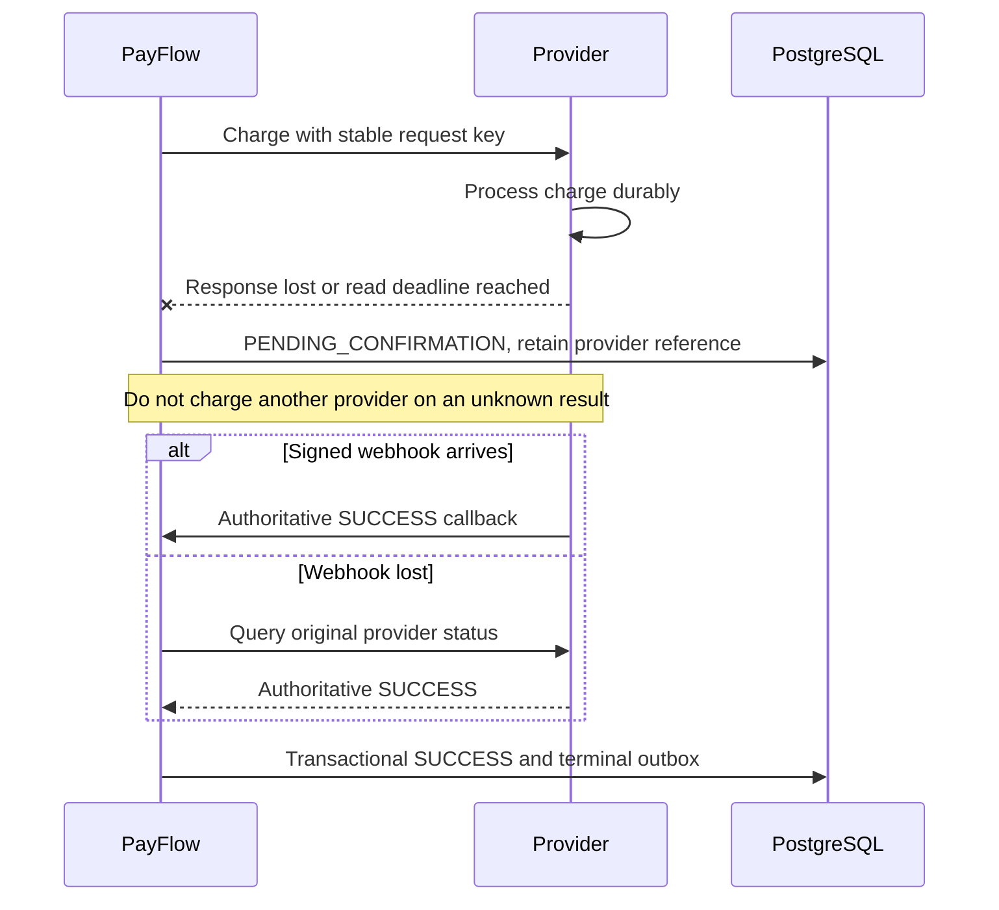

# Failure handling

| Failure | Current system behavior |
|---|---|
| Redis cache unavailable or unreadable | Owned read falls back to PostgreSQL; cache population/eviction failures do not undo committed business state. |
| Redis limiter unavailable | New payment creation fails closed with 503; committed idempotency replay is checked first and again around an admission failure. |
| Merchant limit exceeded | 429 with positive Retry-After; shared Redis window is per merchant. |
| PostgreSQL unavailable | Durable creation/financial transitions cannot proceed; readiness depends on PostgreSQL, liveness does not. |
| Kafka unavailable after creation | Payment and outbox remain durable; publisher retries with lease/backoff/attempt bounds. Processing is delayed and exhausted rows need attention. |
| Mock provider 503 / retryable technical failure | Bounded configured retry; each permitted physical HTTP call has an attempt record. Classification controls whether failover is safe. |
| Repeated technical provider failures | Per-JVM/provider circuit breaker opens, later probes half-open; this is not a globally shared circuit. |
| Provider returns a business decline | Definitive FAILED; decline is not a reason to try charging through a different provider. |
| Provider timeout or uncertain response | PENDING_CONFIRMATION; original provider identity retained, webhook/status reconciliation seeks authoritative outcome. |
| Signed webhook lost | Due reconciliation polls provider status with leases, limits and backoff; unresolved work is not fabricated as success/failure. |
| Duplicate same-payload API request | Payment replay 200; refund replay 202 stored creation response. Conflicting payload returns 409. |
| Duplicate Kafka event | Durable event deduplication and workflow claims/state guards prevent repeating committed transitions. |
| Pod crashes after Kafka acknowledgement | Outbox lease recovery may republish; consumer deduplication remains necessary. |
| Provider result obtained but local finalization fails | Durable attempt/result and stable request key support recovery; claim fencing protects against stale finalization. |
| Duplicate or conflicting webhook | Durable provider/event inbox deduplicates; payload/reference/outcome checks prevent contradictory terminal updates. |
| Refund remains uncertain | Reserved balance remains unavailable; refund reconciliation stays with the original provider. |
| Invalid or exhausted consumer record | Bounded error handling routes to the topic's DLT; no admin replay console is implemented. |

## Why timeout is not failure

Timeout measures what PayFlow observed; it does not prove what the provider did. A lease prevents conflicting local finalization but cannot unsend a request. Retrying the same provider key and reconciling uncertainty protects against double charge. Reconciliation is bounded and unresolved outcomes can remain pending for operator investigation. HTTP acceptance metrics alone cannot prove payment completion.

See [provider orchestration](../src/main/java/com/payflow/payment/service/PaymentOrchestrator.java), [reconciliation](../src/main/java/com/payflow/payment/reconciliation/), and [measured failures](../performance/BASELINE.md).
