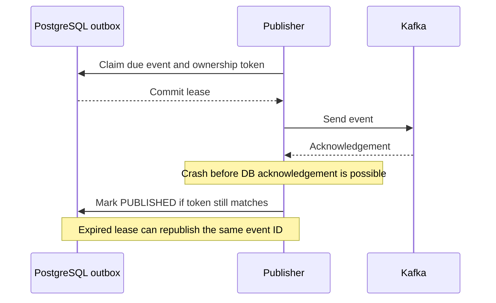

# Transactional outbox

Direct publication leaves a dual-write gap: the payment DB commit succeeds, then Kafka send fails. Reversing the order can publish an event for a rolled-back payment. PayFlow instead commits **business change + event intent in the same PostgreSQL transaction**. The API does not wait for Kafka delivery.

`OutboxService` creates intent; `OutboxStore` claims eligible rows with short DB transactions, database-clock leases, ordering checks and tokens. `OutboxPublisher` sends outside that transaction and waits for acknowledgement with a bound. Success is marked PUBLISHED only for the matching claim. Retry delays/attempt limits and a FAILED state make permanent publication failures visible; this is not infinite automatic delivery.

## At-least-once semantics

If the broker accepts an event but its acknowledgement is lost, or the Pod dies before marking it published, recovery may send it again. The publisher preserves identity, and consumers durably deduplicate. Kafka producer idempotence helps transport retries but does not close a new-process DB/Kafka gap. Do not call this exactly-once processing.

Per-aggregate older unpublished work blocks newer intent. Payment events use paymentId as the key; refund events use refundId in their separate topic. Parent-payment row locks coordinate refund balances across different refund aggregates. Ordering across payment/refund topics is not guaranteed. Financial state guards and parent row locks remain necessary.

During Step 15's outage, all 180 accepted payments eventually reached SUCCESS. This measured recovery is conditional on broker return, valid consumer work and remaining retry budget; failed outbox rows or DLT records still need operational attention. Polling is simple and durable but adds scheduler delay and DB work. CDC/Debezium is a future alternative, not installed.

Source: [publisher and store](../src/main/java/com/payflow/payment/outbox/), [event publisher](../src/main/java/com/payflow/payment/event/PaymentEventPublisher.java). See [failure handling](failure-handling.md).
